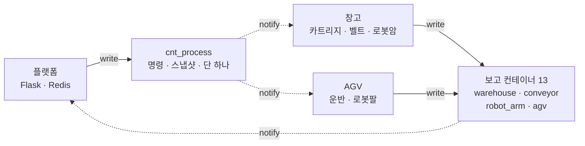
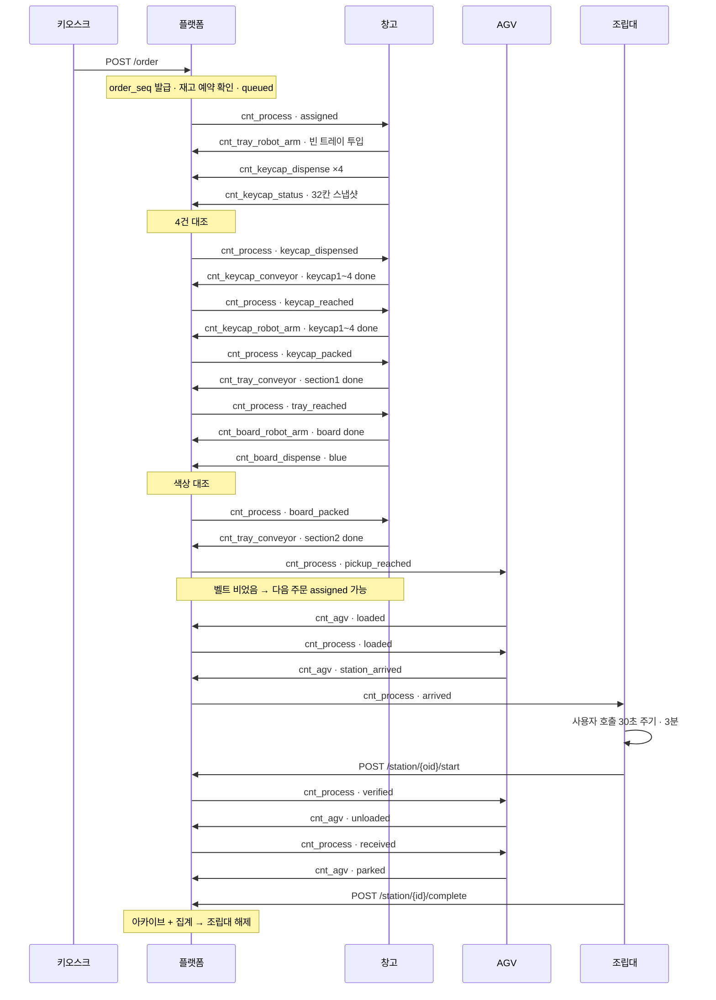
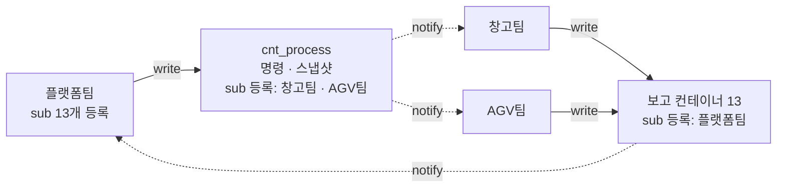

# 스마트 팩토리(COSS 키링) 창고팀 — 사전 정보 총정리

> 작성: 2026-09-14. 2026-09-13~14 대화에서 사용자가 전달한 정보를 빠짐없이 모은 인계 문서입니다.
> **인증값(API KEY, AEI, 강의 코드, creator)은 일부러 넣지 않았습니다.** 팀 노션 / `smart_factory\.env` 에 있습니다.

## 표기 규칙

| 표기 | 뜻 |
|---|---|
| **[원문]** | 사용자가 붙여넣은 팀 노션·문서 내용. 줄바꿈·표·코드까지 가능한 한 그대로 옮김 |
| **[사용자]** | 사용자가 대화 중 직접 설명하거나 결정한 내용 |
| **[이미지]** | 사용자가 보낸 캡처 화면에 보인 내용 |
| **[확인]** | Claude 가 PC·Mobius·gcloud 에서 직접 조회해 확인한 사실 (날짜 표시) |
| **[메모]** | 다른 Claude 대화가 남긴 작업 메모 기준 (직접 재확인 안 함) |

## 목차

1. 프로젝트·역할 개요
2. 사람·팀 구성
3. 장비·센서·PC 환경
4. IoT 플랫폼(iotcoss / Mobius) 접속 정보
5. 이미지로 받은 정보
6. [원문] 팀 노션 — `[ae] SJIOT` CNT 명세 (1차)
7. [원문] COSS 정상 흐름 통신 문서
8. [원문] COSS 전체 로직 명세 (0~10장)
9. [원문] 창고팀 기준 흐름 (17단계)
10. [원문] 창고팀 노션 페이지 — 제어 코드, 통신 구상안, 9/7 현황
11. [원문] 이사님 질의응답
12. [사용자] 대화 중 알려준 사실·결정 (시간순)
13. [원문] 친구분(제어 담당)에게 받은 요청
14. [확인] Mobius·gcloud·PC 실제 상태 조사 결과 (2026-09-13)
15. 문서 간 불일치·미결 사항 모음
16. 현재 코드·진행 상태 (2026-09-14)

---

## 1. 프로젝트·역할 개요

- **프로젝트:** COSS-SHOW 전시회용 스마트 팩토리. 키오스크에서 키보드 부품(보드 + MBTI 글자 키캡 4개) 주문 → 창고가 부품을 트레이에 담음 → AGV 가 조립대로 배달 → 사용자가 조립. [원문·사용자]
- **Mobius AE:** `ae_sjuiot_keyring_2026` (노션 표기는 `[ae] SJIOT`). [이미지·확인]
- **팀:** 플랫폼팀 / 창고팀 / AGV팀. [원문]
- **사용자 = 창고팀.** 담당은 **컨베이어벨트 + 로봇팔 제어와 그 통신 보고.** 카트리지(디스펜서, 아두이노) 출고는 같은 창고팀의 다른 담당. [사용자]
- **사용자 담당 CNT** (사용자가 이미지로 지정, "아마도"라고 함): [사용자·이미지]
  - `cnt_conveyor/cnt_keycap_conveyor`, `cnt_conveyor/cnt_tray_conveyor`
  - `cnt_robot_arm/cnt_keycap_robot_arm`, `cnt_robot_arm/cnt_board_robot_arm`, `cnt_robot_arm/cnt_tray_robot_arm`
- **목표 변화** [사용자]
  - 9/13 오전: "통신이 이어지는 걸 보는 것. 실제 하드웨어 작동 확인은 안 하는 걸로 알고 있음" → 하드웨어 없이 가짜 보고로 통신 확인.
  - 9/13 오후: 조립된 **키캡 2세트**를 실제로 연결해 테스트함 (성공).
  - 불출 검사: "실제로 작동하는지 몰라서 나중에 넣기로 함. 하지만 이 방식이 잘되면 넣을 것" → 로직에는 포함, 센서 확인은 꺼둠.

## 2. 사람·팀 구성

| 이름·호칭 | 내용 | 출처 |
|---|---|---|
| 고정현 (정현님) | 사용자. 창고팀 컨베이어·로봇팔. gcloud 계정 kojunghyun3154 | [이미지] GCP 환영 화면, [원문] 친구분 메시지 |
| 박휴수 | 창고팀. 이사님께 통신 구조 질문을 보냄 | [원문] 11장 |
| 친구분 (이름 미상) | 창고팀. 사용자가 **컨베이어/로봇팔 제어 분리를 부탁**한 사람. gcloud 큐 버전을 따로 만듦 | [사용자] 12장, [원문] 13장 |
| 이사님 | 외부 자문. PC 게이트웨이 구조 권장 | [원문] 11장 |
| 아두이노 담당 (EI 보드 등) | 키캡 카트리지 배출, Cloud Run Flask + HiveMQ MQTT 구현 | [원문] 10장 9/7 현황 |
| 팀원 3~4명 | 테스트용으로 **각자 gcloud 서버**를 만듦. 사용자도 하나 만듦 | [사용자] |

## 3. 장비·센서·PC 환경

### 3-1. 장비 [사용자]
- **Dobot 로봇팔 4대, 컨베이어벨트 3대.** 트레이 벨트는 "아마 3번째일 것 같다".
- **지금 당장 제어는 2세트만.** 실물 조립이 키캡 2세트만 되어 있음.
- 컨베이어는 MagicBox 스텝모터(STP2, index 1)로 구동. [확인: 코드]
- 로봇팔 = Dobot Magician Lite, 컨베이어 제어 = MagicBox. PC 에 **USB 시리얼**로 연결. [확인]
- USB 허브를 쓰면 여러 대 연결에 문제없다고 들음. [사용자]

### 3-2. 센서 [사용자]
- **광전센서 3개, 컬러센서 3개.** 컨베이어벨트 수에 맞게 들어 있음 (벨트당 1개씩).
- 카메라: "사실상 못 쓴다고 생각하거나, 로봇팔 위에 달린 카메라가 아닌 **외부 카메라**로 확인하는 쪽으로 생각만 해보자. 코드 구현은 나중 혹은 작동 안 하게."
- 창고팀 아두이노 카트리지에는 **IR 센서** (배출 성공 판정, 9/7 기준 미배선). [원문 10장]
- DobotLab 코드 주석: "광전센서(최종 컨베이어벨트 전용)". [원문 10장]

### 3-3. 센서 기준 확인 지점 결정 [사용자, 9/13]
Claude 가 키캡 세트 흐름의 확인 지점 ①~⑥ 을 제안했고, 사용자가 이렇게 결정함.

| # | 확인할 것 | 사용자 결정 |
|---|---|---|
| ① | 키캡이 벨트에 떨어졌나 | 카트리지(아두이노) IR — 창고 카트리지 담당 |
| ② | 픽업 위치 도착 | **짧은 브리지/가이드 플레이트를 설치해 물리적으로 제어** |
| ③ | 로봇팔이 목표 좌표 도착 | GetPose (이미 구현) |
| ④ | 실제로 집었나 | **IR(광전) 센서로 확인** |
| ⑤ | 트레이에 제대로 놓였나 | **트레이를 크게 만드는 식으로 해결.** 카메라는 외부 카메라 검토만 |
| ⑥ | 맞는 키캡(색)인가 | **컬러센서 이용하면 좋겠지만 나중에 추가** |

- 광전센서가 벨트당 1개라 픽업 슬롯 2곳을 다 볼 수 없는 문제에 대해, 사용자가 "**시간차로 키캡을 보내면 2번 깜빡이면 되는 것 아님?**"이라고 제안함. → 이후 "웬만하면 **다른 팀이 변동 없게** 진행하면 될 것 같은데, 이 문제는 나중에 생각하자"로 **보류.**

### 3-4. 제어 코드 기준값 (원본 `OneDrive\바탕 화면\two_sets_full.py`, 2026-09-06) [확인]

| 항목 | 세트1 | 세트2 |
|---|---|---|
| 포트 | COM6 | COM7 |
| 컨베이어 index | 1 | 1 |
| 픽업 슬롯1 (x,y,z,r) | (135.8, -279.9, 38.0, -64.1) | (154.9, 258.1, 33.9, 59.0) |
| 픽업 슬롯2 | (136.5, -227.4, 39.7, -59.0) | (153.8, 211.2, 31.6, 53.9) |
| place 슬롯1 | (248.5, -94.7, -19.8, -20.9) | (239.5, 91.3, -18.8, 20.8) |
| place 슬롯2 | (242.5, 103.2, -12.6, 23.0) | (237.1, -104.6, -21.5, -23.8) |
| 키캡 | "1번 키캡"(슬롯1), "2번 키캡"(슬롯2) | "3번 키캡"(슬롯1), "4번 키캡"(슬롯2) |

- 공통값: `CONVEYOR_SPEED=50`(mm/s), `CONVEYOR_RUN_TIME=6.0`초 (9/18 시연 전 8→6), `GRIP_SETTLE_DELAY=0.5`, `RELEASE_SETTLE_DELAY=0.5`, `MOVE_SETTLE_DELAY=0.5`, `INTER_KEYCAP_DELAY=3.0`, `LIFT_Z_OFFSET=50.0`, `CALL_TIMEOUT=5`, PTP 모드 0(JUMP).
- 속도 변환: `_MM_TO_PULSE = (360/1.8 × 5 × 16) / (π × 32)`.
- **9/6 트러블슈팅으로 확정한 규칙:**
  1. `isQueued=False` 로 통일
  2. PTP 의 True 응답을 믿지 않고 `GetPose` 로 실제 도착 확인 (허용오차 3mm, 최대 8초)
  3. 그리퍼 동작 직후 대기 (안 하면 바로 뒤 PTP 명령이 씹힘)
  4. 스레드 사용 금지, `asyncio.gather()` 로만 동시 실행 (DobotRPC 가 이벤트루프 하나에 묶여 있어서, 스레드마다 루프를 만들면 응답을 못 받음)
  5. 종료 시 호밍 대신 마지막 place 위치에서 z 만 들어올림 (호밍 시 관절 한계 문제 재현)
- 흐름: 그리퍼 오픈 → 컨베이어 6초 1회 → 키캡마다 픽업→place → 그리퍼 오픈 → z 리프트 → 그리퍼 전원 차단. 세트1·2 동시.
- **place_slots 는 최종 트레이가 아니라 중간 위치.** 트레이 자체가 없어서 벨트에서 집어 옮기는 것까지만 구현됨. [사용자: 친구분 답변 전달]
- 바탕화면의 개발 과정 파일(9/6): `probe_two_arms.py`, `identify_set.py`, `find_conveyor_namespace.py`, `inspect_dobotlink.py`, `search_devices.py`, `test_set2_alone.py`, `set1_full_set2_probe.py`(세트1 전체 + 세트2 왕복), `run_both_conveyors.py`(컨베이어 2개 동시). [확인]

### 3-5. PC 환경 [확인]
- Windows 11, VS Code. Python **3.14**(`python`)와 **3.9**(`C:\Python39`, `py -3.9`).
- **DobotRPC 4.8.8 은 Python 3.9 에만 설치.** 3.9 에 requests / python-dotenv / flask 도 설치함.
- DobotLink 6.7.7 edu 설치 (`Downloads` 에 설치 파일).
- 장치 관리자: **USB 직렬 장치 COM6, COM7** (Dobot), 블루투스 직렬 COM3, COM4. [이미지]
- gcloud CLI 설치·로그인 (계정 kojunghyun3154@gmail.com, 프로젝트 `project-26553d54-9fe6-4793-90a`).

## 4. IoT 플랫폼(iotcoss / Mobius) 접속 정보

### 4-1. 접속값 [원문, 값 일부 비공개]
사용자가 노션에서 가져온 **팀 공용 인증값**. 개인 발급 키가 아니며, 노션 팀 정리 페이지에 있음. [사용자]
```
mp_url(mobius_url): https://onem2m.iotcoss.ac.kr
cb: Mobius
aei: (비공개 — 노션/.env)
ae_rn: ae_sjuiot_keyring_2026
api_key: (비공개)
custom_lecture: (비공개)
custom_creator: (비공개)
```
- 요청 헤더 (통신 구상안 코드 기준, [확인]으로 동작 검증): `X-M2M-RI`(요청마다 새 값), `X-M2M-Origin`(= aei), `X-API-KEY`, `X-AUTH-CUSTOM-LECTURE`, `X-AUTH-CUSTOM-CREATOR`, `Accept: application/json`, 생성 시 `Content-Type: application/json;ty=N` (3=컨테이너, 4=CIN, 23=구독).
- 기본 경로: `https://onem2m.iotcoss.ac.kr/Mobius/ae_sjuiot_keyring_2026/...`
- 최신 CIN 조회: `GET .../{컨테이너}/la`, 자식 찾기: `GET ...?fu=1&ty=3`(컨테이너) / `ty=23`(구독).
- [확인] Windows PowerShell 의 `Invoke-WebRequest` 로는 400 이 나고, `curl.exe` 와 Python `requests` 는 정상.

### 4-2. 플랫폼 학생 포털 (Downloads\학생가이드.pptx 요약) [확인]
- 사물인터넷 혁신융합대학사업단 IoT 플랫폼 학생 포털 매뉴얼.
- 로그인 `https://platform.iotcoss.ac.kr/login` (소셜 / 이메일 회원가입: 실명, 이메일, 비밀번호 6자 이상, 학교, 학과, 학번).
- 프로필 `/dashboard/profile`: oneM2M API 호출용 **개인 API KEY 와 식별 코드 조회.**
- 공지사항 `/dashboard/notices`, 공통 학습자료 `/dashboard/common-material`, 개설 수업 `/dashboard/courses` (수강 신청, 수업용 데이터 트리·엑셀).
- 내 데이터 목록 `/dashboard/sensors` → **리소스 트리** `/dashboard/sensors/{ae_ri}`. CIN 은 최근 5건만 보이고 "더보기"로 전체.
- API 명세 가이드 `/api-guide`, Swagger `/api-docs` (GET/POST/PUT/DELETE, POST/PUT 시 `lbl` 에 과제명 포함 가능, Mobius ↔ tinyIoT 전환, API KEY·식별 코드·수업 ID 입력), Postman 스크립트 다운로드.

## 5. 이미지로 받은 정보

### 5-1. Mobius 리소스 트리 (첫 캡처, 2026-09-13 오전 전달) [이미지]
```
Mobius                          (유형: CSEBase)
└─ ae_sjuiot_keyring_2026       (AE(디바이스), 최종 업데이트 2026.9.6 오전 2:09:20)
   ├─ cnt_warehouse             (Container, 2026.9.6 오전 3:07:58)
   ├─ cnt_conveyor              (2026.9.6 오전 3:08:03)
   │  ├─ cnt_keycap_conveyor    (2026.9.11 오후 11:59:37)
   │  └─ cnt_tray_conveyor      (2026.9.11 오후 11:59:37)
   ├─ cnt_robot_arm             (2026.9.6 오전 3:08:10)
   │  ├─ cnt_keycap_robot_arm   (2026.9.11 오후 11:59:38)
   │  ├─ cnt_board_robot_arm    (2026.9.11 오후 11:59:39)
   │  └─ cnt_tray_robot_arm     (2026.9.11 오후 11:59:39)
   ├─ cnt_order                 (2026.9.11 오후 11:59:36)
   ├─ cnt_agv                   (2026.9.11 오후 11:59:40)
   ├─ cnt_process               (2026.9.12 오전 12:45:37)
   └─ cnt_station               (2026.9.11 오후 11:58:25)
```

### 5-2. 담당 범위 캡처 [이미지]
`cnt_conveyor`(cnt_keycap_conveyor, cnt_tray_conveyor) 와 `cnt_robot_arm`(cnt_keycap_robot_arm, cnt_board_robot_arm, cnt_tray_robot_arm) 부분만 캡처. 시각은 5-1 과 같음. 사용자: "이미지에 있는 거를 우리가 담당하는 걸로 알고 있긴 해. 아마도".

### 5-3. GCP 콘솔 환영 화면 [이미지]
"고정현님, 환영합니다." 무료 체험판 사용 중, **₩0 / ₩414,984 크레딧 사용**, **2026년 12월 10일 만료**. 프로젝트 ID `project-26553d54-9fe6-4793-90a` (My First Project). 안내: 체험 종료 후 자동 청구 없음, 일반 계정 활성화 전까지 리소스가 삭제될 수 있음.

### 5-4. 테스트 결과 캡처 (9/13) [이미지]
- `cnt_test_warehouse_arm` 아래 1단계 글 `{"message":"hello mobius","sent_at":"2026-09-13 15:06:04"}`, `cnt_process` 에 order_test_153114 의 status 사진 6장 (assigned → board_packed, 15:31:13~22).
- `cnt_conveyor` 보고: `cnt_keycap_conveyor` 에 `{"order_id":"order_test_153114","keycap1":"done",...,"keycap4":"done"}`, `cnt_tray_conveyor` 에 section1·section2 done (order_test_152452 와 153114 두 주문).
- 이 테스트 폴더들은 9/14 에 삭제됨. [메모]

### 5-5. 기타 캡처 [이미지]
- 장치 관리자 포트: USB 직렬 장치(COM6), USB 직렬 장치(COM7), 표준 Bluetooth 직렬 링크(COM3, COM4).
- 9/13 저녁 Mobius 트리: 기존 컨테이너 + `cnt_test_warehouse_arm`(9.13 오후 3:06:02), `cnt_test_warehouse_arm_pc`(9.13 오후 4:55:04).
- VS Code 알림: "An environment file is configured but terminal environment injection is disabled..." (Python Environments 확장 안내, 무시해도 됨).
- 노션 붙여넣기 안의 `!image.png` 자리 3곳 ("DobotLab 코드 아래", "구상안 스케치 (임시)", "통신 구상안_1차"): **이미지 자체는 전달되지 않음.**

---

## 6. [원문] 팀 노션 — `[ae] SJIOT` CNT 명세 (1차)

> 사용자가 가장 먼저 붙여넣은 페이지. 첫 줄 "AGV가 항상 픽업대에 대기하는 구조".
> 창고팀 부분(`cnt_warehouse` ~ `cnt_robot_arm`)은 뒤에 10장 창고팀 페이지에서 **같은 내용으로 한 번 더** 전달됨.

AGV가 항상 픽업대에 대기하는 구조

[ae] SJIOT

- [플랫폼팀] cnt_process

```json
{
	"seq": 8843,
  "updated_at": "2026-09-04T16:20:11+09:00",
  "orders": {
				 "ord_1234": {
								"station_id": "1",
								"status": "(아래 표 참고)",
								"board": "blue", 
								"keycap": "ESFJ", 
								"colors": ["r","y","b","g"]
						 } },
  "restock": ["E_r", "S_g"]
}
```

## status — 흐름 순서

| status | 상태 | 다음 명령 (수행 주체) | 판정 근거 |
| --- | --- | --- | --- |
| `queued` | 대기열 — 조립대 미배정 | — (Redis에만. `cnt_process`에는 안 올림) | `POST /order` |
| `assigned` | 조립대 배정 | **트레이 로봇팔** — 빈 트레이를 컨베이어에 올림<br>**키캡 카트리지** — 주문에 맞는 4칸 출고 | 조립대 빈 칸 발생 |
| `keycap_mismatched` | 출고된 키캡이 주문과 불일치 | **키캡 카트리지** — 재출고 | `cnt_keycap_dispense` 4건 대조 |
| `keycap_dispensed` | 키캡 4개 출고 완료 | **키캡 컨베이어** — 로봇팔 위치까지 | `cnt_keycap_dispense` ×4 |
| `keycap_reached` | 키캡·트레이가 로봇팔 위치 도착 | **키캡 로봇팔** — 트레이에 키캡 4개 적재 | `cnt_keycap_conveyor` |
| `keycap_packed` | 키캡 트레이 적재 완료 | **트레이 컨베이어** — 보드 위치까지 | `cnt_keycap_robot_arm` ×4 |
| `tray_reached` | 트레이가 보드 위치 도착 | **보드 로봇팔** — 보드를 트레이에 투입 | `cnt_tray_conveyor` section1 |
| `board_mismatched` | 투입된 보드가 주문과 불일치 | **보드 로봇팔** — 재투입 | `cnt_board_dispense` 대조 |
| `board_packed` | 보드 트레이 적재 완료 | **트레이 컨베이어** — 끝(AGV 대기장소)까지 | `cnt_board_robot_arm` + dispense |
| `pickup_reached` | 트레이가 AGV 대기장소 도착 | **AGV 로봇팔** — 트레이 적재<br>**키캡 카트리지** — 다음 주문 출고 시작 | `cnt_tray_conveyor` section2 |
| `loaded` | AGV 적재 완료 | **AGV** — 배정된 조립대로 출발 | `cnt_agv` `loaded` |
| `arrived` | AGV가 조립대 도착 | **플랫폼** — 사용자 호출 (30초 주기 3분) + 노쇼 타이머 시작 | `cnt_agv` `station_arrived` |
| `unclaimed` | 노쇼 — 도착 후 3분 초과 | **AGV** — 폐기장소 이동 → 폐기 → 복귀 | 플랫폼 타이머 |
| `verified` | QR 인증 완료 | **AGV** — 트레이 하차 | `POST /station/{oid}/start` |
| `received` | 사용자가 부품 수령 | **AGV** — 대기장소 복귀 → `parked` 보고해야 다음 주문 가능 | `cnt_agv` `unloaded` |
| `completed` | 조립 완료 · 주문 종료 | **플랫폼** — 조립대 해제 → 다음 주문 배정 | 완료 버튼 / 조립 타임아웃 |

## fault

실패는 모두 여기서 관리. status에 추가하지 않음

| 구분 | fault | 상태 | 명령 수행 주체 |
| --- | --- | --- | --- |
| 컨베이어 | keycap_01_belt_jammed<br>keycap_02_belt_jammed<br>tray_01_belt_jammed<br>tray_02_belt_jammed | 벨트 구간별 정리 | 창고 |
| 카트리지 | keycap_cartridge_failed<br>~~board_catridge_failed~~ (취소선) | 오배출, 고장 | 창고 |
| 로봇암 | keycap_pack_failed<br>board_pack_failed<br>tray_load_failed | 트레이 적재, 투입 실패 | 창고 / agv |
| AGV | pickup_failed<br>drop_failed<br>agv_collided<br>agv_broken | 픽업, 하차 실패, 이동 중 사고, 자체 고장 | agv |
| 재고 | keycap_empty<br>board_empty | 출고 도중 재고 소진 | 창고 |
| 플랫폼 | stage_timeout | 단계 체류 시간 초과 — 보고가 아예 안 올 때 유일한 감지 수단 | 플랫폼 |

- [창고팀] **cnt_warehouse**
    - 배출 정보
        - **cnt_keycap_dispense**

            ```c
            {"order_id": "order_x",
             "keycap": "E_r"}
            ```

            | cin | 의미 |
            | --- | --- |
            | order_id | 배출한 주문 |
            | keycap | 배출된 부품 (글자_색상) |
        - **cnt_board_dispense**

            ```c
            {"order_id": "order_x",
             "board": "blue"}
            ```

            | cin | 의미 |
            | --- | --- |
            | order_id | 배출한 주문 |
            | board | 배출된 보드 색깔 |
    - 상태 정보 cnt_keycap_status / cnt_alphabet_color
        - 키캡 32개 → ex) **cnt_keycap_status** / **cnt_E_r**

            ```json
            {"order_id": "order_x",
             "count": 7,
             "status": "idle"}
            ```

        - 보드 4개 → ex) **cnt_board_status** / **cnt_blue**

            ```jsx
            {"order_id": "order_x",
             "count": 5,
             "status": "disable",
             "reason": "jammed"}
            ```

        | cin | 의미 |
        | --- | --- |
        | order_id | 이 레일을 마지막으로 사용한 주문 |
        | count | 현재 재고 수량 |
        | status | idle(대기) / busy(배출 중) / disable(오배출) / empty(재고 부족) |
- [창고팀] **cnt_conveyor**
    - **cnt_keycap_conveyor**

        ```json
        {"order_id": "order_x",
        "status": {"keycap1": "done",
                    "keycap2": "done",
                    "keycap3": "done",
                    "keycap4": "done"}}
        ```

        | cin | 의미 |
        | --- | --- |
        | keycap1~4 | 키캡 4개 각각의 이송 완료 여부 (done/failed) |
    - **cnt_tray_conveyor**

        ```json
        {"order_id": "order_x",
        "section1": "done"}
        ```

        | cin | 의미 |
        | --- | --- |
        | section1 / section2 | 트레이 벨트 해당 구간 작동 완료 여부 (done/failed) |
- [창고팀] **cnt_robot_arm**
    - **cnt_keycap_robot_arm**

    ```json
    {"order_id": "order_x",
     "keycap1": "done"}
    ```

    | cin | 의미 |
    | --- | --- |
    | keycap1~4 | 해당 키캡 배치 결과 (done/failed) |

    | cin | 의미 |
    | --- | --- |
    | keycap1 | EI 선반 |
    | keycap2 | NS 선반 |
    | keycap3 | TF 선반 |
    | keycap4 | PJ 선반 |
    - **cnt_board_robot_arm**

        ```json
        {"order_id": "order_x",
        "board": "done"}
        ```

        | cin | 의미 |
        | --- | --- |
        | board | 보드 배치 결과 (done/failed) |
    - **cnt_tray_robot_arm**

        ```json
        {"order_id": "order_x",
        "status": "done"}
        ```

        | cin | 의미 |
        | --- | --- |
        | status | 트레이 배치 완료 여부 (done/failed) |
- [AGV팀] cnt_agv

    ```json
    {
      "m2m:cin": {
        "con": {
    	    "order_id": "ord_x",
    	    "station_id": "1",
          "status": "loaded",
        }
      }
    }
    ```

    | **status** | **의미** |
    | --- | --- |
    | parked | AGV가 픽업대에 있음(대기장소) |
    | loaded | AGV에 트레이 적재 완료 |
    | station_arrived | AGV가 지정 조립대에 도착 |
    | unloaded | 조립대에 트레이 하차 완료 / 폐기 장소로 이동 후 폐기 완료 |
    | load_failed | AGV가 트레이 적재 실패 |
    | unload_failed | 조립대에 트레이 하차 실패 |
    | move_accident | AGV 이동 중 사고 |
    | discarded | 폐기 완료 |
- [플랫폼팀] cnt_station

    ```json
    {
    	"1":{
    				"order_id": "ord_xxxx",
    				"order_seq": "109"
    			}
    	"2":{
    				"order_id": "ord_xxxx",
    				"order_seq": "111"
    			}
    	"3":{
    				"order_id": "ord_xxxx",
    				"order_seq": "110"
    			}
    }
    ```

---

## 7. [원문] COSS 정상 흐름 통신 문서

> 6장 다음에 붙여넣은 문서. 8장 "전체 로직 명세"의 요약판에 가깝지만 표현이 조금 달라 전부 옮김.

## 1. 한눈에



**명령은 `cnt_process` 하나에서만 나간다.** 머신은 그것만 구독하고, 자기 차례의 `status`에만 반응한다. 머신끼리 직접 통신하지 않는다.

| 전제 | 값 |
| --- | --- |
| 주문 처리 | **한 번에 1건.** 벨트 위 트레이는 항상 1개 |
| AGV | **1대. 픽업대 = 대기장소** — 항상 픽업대에 대기 |
| 다음 주문 시작 | `pickup_reached` 시점 (트레이가 픽업대 도착 = 벨트 비었음) |
| 명령 자족성 | 수행에 필요한 값을 전부 `cnt_process`에 실음. 다른 컨테이너 참조 없음 |

---

## 2. 시퀀스



---

## 3. 정상 흐름 29단계

플랫폼이 `status`를 바꿔 push하면, 그 status가 자기 차례인 머신이 동작하고 결과를 자기 컨테이너에 올린다. 이 왕복이 계속된다.

### 주문 접수 · 조립대 배정

| # | 주체 | 컨테이너 | con · 동작 | → status |
| --- | --- | --- | --- | --- |
| 1 | 키오스크 | `POST /order` | `{board, keycap, colors}` | `queued` (Redis만) |
| 2 | 플랫폼 | `cnt_process` | 빈 조립대 + 벨트 비었음 확인 → push | **`assigned`** |

### 키캡 출고

| # | 주체 | 컨테이너 | con · 동작 | → status |
| --- | --- | --- | --- | --- |
| 3 | 트레이 로봇암 | `cnt_tray_robot_arm` | `{order_id, status:"done"}` — 빈 트레이 벨트 투입 |  |
| 4 | 키캡 카트리지 | `cnt_keycap_dispense` | `{order_id, keycap:"E_r"}` **×4** — 배출마다 1건 |  |
| 5 | 키캡 카트리지 | `cnt_keycap_status` | `{cartridges:{E_r:{count:n-1, status:"idle"}}}` |  |
| 6 | 플랫폼 | `cnt_process` | **4건 모두 받은 뒤** 주문 내역과 대조 | **`keycap_dispensed`** |

### 키캡 이송 · 트레이 적재

| # | 주체 | 컨테이너 | con · 동작 | → status |
| --- | --- | --- | --- | --- |
| 7 | 키캡 컨베이어 | `cnt_keycap_conveyor` | `{order_id, keycap1~4:"done"}` — 로봇암 앞까지 |  |
| 8 | 플랫폼 | `cnt_process` | 4개 모두 done 확인 | **`keycap_reached`** |
| 9 | 키캡 로봇암 | `cnt_keycap_robot_arm` | `{order_id, keycap1~4:"done"}` — 적재 + 카메라 확인 |  |
| 10 | 플랫폼 | `cnt_process` | 4개 모두 done 확인 | **`keycap_packed`** |

### 트레이 이동 · 보드 적재

| # | 주체 | 컨테이너 | con · 동작 | → status |
| --- | --- | --- | --- | --- |
| 11 | 트레이 컨베이어 | `cnt_tray_conveyor` | `{order_id, section1:"done"}` — 보드 로봇암 앞까지 |  |
| 12 | 플랫폼 | `cnt_process` |  | **`tray_reached`** |
| 13 | 보드 로봇암 | `cnt_board_robot_arm` | `{order_id, board:"done"}` — 카트리지 → 트레이 직접 투입 |  |
| 14 | 보드 카트리지 | `cnt_board_status` | `{cartridges:{blue:{count:n-1, status:"idle"}}}` |  |
| 15 | 보드 로봇암 | `cnt_board_dispense` | `{order_id, board:"blue"}` |  |
| 16 | 플랫폼 | `cnt_process` | **색상 대조** (blue == 주문 board) | **`board_packed`** |

### 픽업 · 배송

| # | 주체 | 컨테이너 | con · 동작 | → status |
| --- | --- | --- | --- | --- |
| 17 | 트레이 컨베이어 | `cnt_tray_conveyor` | `{order_id, section2:"done"}` — 픽업대까지 |  |
| 18 | 플랫폼 | `cnt_process` | **다음 주문 assigned 가능** | **`pickup_reached`** |
| 19 | AGV 로봇팔 | `cnt_agv` | `{status:"loaded"}` — AGV는 픽업대에 상시 대기 |  |
| 20 | 플랫폼 | `cnt_process` | `agv:occupancy = busy` | **`loaded`** |
| 21 | AGV | `cnt_agv` | `{status:"station_arrived"}` — 조립대로 이동 |  |
| 22 | 플랫폼 | `cnt_process` | `station:arrived_at` 기록 (노쇼 타이머 시작) | **`arrived`** |

### 인증 · 수령 · 완료

| # | 주체 | 컨테이너 | con · 동작 | → status |
| --- | --- | --- | --- | --- |
| 23 | 조립대 | — | 사용자 호출 — 30초 주기, 3분간 |  |
| 24 | 사용자 | `POST /station/{oid}/start` | QR 인증 | **`verified`** |
| 25 | AGV | `cnt_agv` | `{status:"unloaded"}` — 트레이 하차 |  |
| 26 | 플랫폼 | `cnt_process` |  | **`received`** |
| 27 | AGV | `cnt_agv` | `{status:"parked"}` → `agv:occupancy = idle` |  |
| 28 | 사용자·관리자 | `POST /station/{id}/complete` | 완료 버튼 또는 조립 타임아웃 10분 | **`completed`** |
| 29 | 플랫폼 | `cnt_order` · Redis | 아카이브 + 집계 → 조립대 해제 → 다음 주문 배정 | 스냅샷에서 제거 |

> **대조는 두 곳에서만.** 6단계 키캡 4건과 16단계 보드 색상 — 이 둘만 플랫폼이 주문 내역과 맞춰본다. 나머지 단계는 `done`/`failed`만 보고 넘어간다.
>
> 키캡 대조는 **4건이 다 온 뒤 한 번에** 한다. 중간에 즉시 판정하면 재출고분이 트레이에 담기는 순서가 꼬인다.

---

## 4. 노쇼 경로

22단계에서 갈라진다. 도착 후 3분 안에 인증이 없으면 주문을 종료하고 부품을 폐기한다.

| # | 주체 | 컨테이너 | con · 동작 | → status |
| --- | --- | --- | --- | --- |
| 22′ | 플랫폼 | `cnt_process` | 도착 후 3분 경과, 인증 없음 | **`unclaimed`** |
| 23′ | AGV | `cnt_agv` | `{status:"discarded"}` — 폐기장소 이동 → 폐기 |  |
| 24′ | AGV | `cnt_agv` | `{status:"parked"}` — 대기장소 복귀 |  |
| 25′ | 플랫폼 | `cnt_order` · Redis | 아카이브 + 집계 → 조립대 해제 | 스냅샷에서 제거 |

> **폐기 부품의 재고는 추가 차감하지 않는다.** 출고 시점(4·13단계)에 이미 카트리지 `count`가 줄었다.

---

## 5. 컨테이너 한 줄 요약

| 컨테이너 | write | 구독 | 이 흐름에서 하는 일 |
| --- | --- | --- | --- |
| **`cnt_process`** | 플랫폼 | 창고·AGV | 모든 명령. status가 바뀔 때마다 전체 스냅샷 push (2·6·8·10·12·16·18·20·22·24·26·28) |
| `cnt_tray_robot_arm` | 창고 | 플랫폼 | 3 — 빈 트레이 투입 |
| `cnt_keycap_dispense` | 창고 | 플랫폼 | 4 — 배출마다 1건, 주문당 4건 |
| `cnt_keycap_status` | 창고 | 플랫폼 | 5 — 32칸 재고 스냅샷 |
| `cnt_keycap_conveyor` | 창고 | 플랫폼 | 7 — 키캡 이송 완료 |
| `cnt_keycap_robot_arm` | 창고 | 플랫폼 | 9 — 트레이 적재 |
| `cnt_tray_conveyor` | 창고 | 플랫폼 | 11 · 17 — section1 · section2 |
| `cnt_board_robot_arm` | 창고 | 플랫폼 | 13 — 보드 투입 |
| `cnt_board_status` | 창고 | 플랫폼 | 14 — 4칸 재고 스냅샷 |
| `cnt_board_dispense` | 창고 | 플랫폼 | 15 — 배출 색상 |
| `cnt_agv` | AGV | 플랫폼 | 19 · 21 · 25 · 27 — 적재 · 도착 · 하차 · 복귀 |
| `cnt_station` | 플랫폼 | — | 조립대 배정 변경 시 기록. 구독자 없음 |
| `cnt_order` | 플랫폼 | — | 29 — 종료 시 1건 아카이브. 구독자 없음 |

> **이 문서에 없는 것** — `fault` 17값 · 타임아웃 · 재고 예약 · `mismatched` 재출고 · 부분 실패 처리. 전부 「COSS 전체 로직 명세」에 있다.

---

## 8. [원문] COSS 전체 로직 명세 (0~10장)

## 0. 확정 전제

| 항목 | 값 |
| --- | --- |
| 주문 처리 | **한 번에 1건.** 벨트 위 트레이는 항상 1개 |
| 트레이 | 20개 (회수는 사람이 수동) |
| AGV | **1대. 픽업대 = 대기장소** — 항상 픽업대에 대기 |
| 조립대 | 3칸 |
| 다음 주문 시작 | `pickup_reached` 시점 (트레이가 픽업대 도착) |
| 사용자 취소 | **미구현** — 이번 범위 제외 |
| 조립 미완료 이탈 | `completed`로 일괄 처리 — 관리자 완료 버튼 / 타임아웃 모두 동일 |
| 명령 채널 | `cnt_process` 하나. 머신은 이것만 구독 |
| 명령 자족성 | 수행에 필요한 값을 전부 `cnt_process`에 실음. 다른 컨테이너 참조 없음 |

## 1. 리소스 트리

```
{CB}/SJIOT/
├─ cnt_process                       [플랫폼 write]  sub 2 (창고 · AGV)
├─ cnt_station                       [플랫폼 write]  sub 0 · 기록용
├─ cnt_order                         [플랫폼 write]  sub 0 · 기록용
│
├─ cnt_warehouse                     [창고 write]
│  ├─ cnt_keycap_status              32칸 종합 스냅샷   ← 신설 요청  [플랫폼 sub]
│  │   └─ cnt_E_r · cnt_S_y · …      키캡 카트리지 32 · 창고 내부
│  ├─ cnt_board_status               4칸 종합 스냅샷    ← 신설 요청  [플랫폼 sub]
│  │   └─ cnt_blue · cnt_red · …     보드 카트리지 4 · 창고 내부
│  ├─ cnt_keycap_dispense            키캡 배출 이벤트              [플랫폼 sub]
│  └─ cnt_board_dispense             보드 배출 이벤트              [플랫폼 sub]
│
├─ cnt_conveyor                      [창고 write]
│  ├─ cnt_keycap_conveyor            키캡 벨트 2구간               [플랫폼 sub]
│  └─ cnt_tray_conveyor              트레이 벨트 2구간             [플랫폼 sub]
│
├─ cnt_robot_arm                     [창고 write]
│  ├─ cnt_keycap_robot_arm           cnt_keycap1 ~ cnt_keycap4    [플랫폼 sub ×4]
│  ├─ cnt_board_robot_arm            보드 배치 결과                [플랫폼 sub]
│  └─ cnt_tray_robot_arm             빈 트레이 벨트 투입           [플랫폼 sub]
│
└─ cnt_agv                           [AGV write]                  [플랫폼 sub]
```

### 1-1. 구독은 자식으로 캐스케이드되지 않는다

oneM2M 구독은 **그 리소스에 생성된 CIN만** 알린다. `cnt_warehouse`를 구독해도 `cnt_E_r`의 CIN은 오지 않는다.

---

| 대상 | 개수 | 처리 |
| --- | --- | --- |
| `cnt_keycap_status/*` | 32 | **부모 종합 스냅샷으로 통합 요청** |
| `cnt_board_status/*` | 4 | 동일 |
| `cnt_keycap_dispense` · `cnt_board_dispense` | 2 | 개별 구독 (이벤트) |
| `cnt_keycap_conveyor` · `cnt_tray_conveyor` | 2 | 개별 구독 |
| `cnt_keycap_robot_arm/*` (4) · `board` · `tray` | 6 | 개별 구독 |
| `cnt_agv` | 1 | 개별 구독 |

```json
// cnt_warehouse/cnt_keycap_status  — 키캡 배출이 끝난 뒤
{
  "updated_at": "2026-09-04T16:20:11+09:00",
  "cartridges": {
    "E_r": {"count": 6, "status": "idle"},
    "S_y": {"count": 3, "status": "idle"},
    "F_b": {"count": 5, "status": "disable", "reason": "jammed"},
    "J_g": {"count": 0, "status": "empty"}
  }
}
```

### 1-2. `cnt_keycap_dispense`와 `cnt_keycap_status`가 둘 다 필요한 이유

| 컨테이너 | 답하는 질문 | 용도 |
| --- | --- | --- |
| `cnt_*_dispense` | **무엇이 나왔나** (이벤트) | 주문 내역과 대조 → `mismatched` 판정 |
| `cnt_*_status` | **몇 개 남았고 멀쩡한가** (상태) | 재고 표시 · `disable`/`empty` 감지 |

카트리지가 아예 안 뱉는 고장(`jammed`·`motor_failure`)은 **dispense CIN이 올라오지 않으므로** status로만 알 수 있다.

---

## 2. `cnt_process` — 명령 스냅샷

```json
{
  "seq": 8843,
  "updated_at": "2026-09-04T16:20:11+09:00",
  "orders": {
    "ord_1234": {
      "station_id": "1",
      "order_seq": 109,
      "status": "keycap_reached",
      "board": "blue",
      "keycap": "ESFJ",
      "colors": ["r", "y", "b", "g"],
      "fault": null
    }
  },
  "key_restock":   ["E_r", "J_g"],
  "board_restock": ["blue", "red"]
}
```

| 필드 | 내용 |
| --- | --- |
| `seq` | 스냅샷 일련번호. 내용이 바뀔 때만 증가 → 수신측이 "seq 같으면 무시"로 주기 재전송을 거름 |
| `orders` | 진행 중 주문만. 종료되면 다음 push에서 제거 |
| `fault` | 오류 시에만 값. 있으면 그 주문 정지 (4장) |
| `key_restock` | 채워야 할 키캡 배열 |
| `board_restock` | 채워야 할 보드 배열 |

**컨테이너 속성** — `mni` 10~50. 최신 1건만 유효하고 주기 재전송이 쌓이므로 작게.

### 2-1. status — 16값

| # | status | 상태 | 명령 수행 주체 | 전이 신호 |
| --- | --- | --- | --- | --- |
| — | `queued` | 대기열 | — | **Redis만.** cnt_process에 안 올림 |
| 1 | `assigned` | 조립대 배정 | 트레이 로봇암 (빈 트레이 투입) · 키캡 카트리지 (출고) | 조립대 빈 칸 발생 |
| 2 | `keycap_mismatched` | 출고 키캡 불일치 | 키캡 카트리지 (재출고) | dispense 4건 대조 |
| 3 | `keycap_dispensed` | 키캡 4개 출고 완료 | 키캡 컨베이어 (2구간 작동) | `cnt_keycap_dispense` ×4 |
| 4 | `keycap_reached` | 키캡 로봇암 앞 도착 | 키캡 로봇암 (트레이에 적재) | `cnt_keycap_conveyor` 4개 done |
| 5 | `keycap_packed` | 키캡 트레이 적재 | 트레이 컨베이어 (section1) | `cnt_keycap_robot_arm` ×4 done |
| 6 | `tray_reached` | 보드 로봇암 앞 도착 | 보드 로봇암 (보드 투입) | `cnt_tray_conveyor` section1 |
| 7 | `board_mismatched` | 출고 보드 불일치 | 보드 로봇암 (재출고) | `cnt_board_dispense` 대조 |
| 8 | `board_packed` | 보드 트레이 적재 | 트레이 컨베이어 (section2) | `cnt_board_robot_arm` + dispense |
| 9 | `pickup_reached` | 픽업대 도착 | AGV 로봇팔 (적재) · **창고: 다음 주문 시작 가능** | `cnt_tray_conveyor` section2 |
| 10 | `loaded` | AGV 적재 완료 | AGV (조립대로 출발) | `cnt_agv` loaded |
| 11 | `arrived` | 조립대 도착 | 조립대 (사용자 호출 · 30초 주기 3분) | `cnt_agv` station_arrived |
| 12 | `unclaimed` | 노쇼 (3분 초과) | AGV (폐기장소 → 폐기 → 복귀) | 플랫폼 타이머 |
| 13 | `verified` | QR 인증 완료 | AGV (트레이 하차) | `POST /station/{oid}/start` |
| 14 | `received` | 사용자 부품 수령 | AGV (대기장소 복귀) | `cnt_agv` unloaded |
| 15 | `completed` | 조립 완료 · 종료 | 조립대 배정 가능 | 완료 버튼 / 조립 타임아웃 |

> **제외된 값** — 인증 후 이탈은 전부 `completed`로 일괄 처리. `mismatched` 2회 초과 시에만 시스템 취소가 필요한데, 그 경우도 `completed`로 종료하고 관리자 페이지에 사유를 남긴다.

### 2-2. `assigned`를 쪼개지 않는 이유

주문을 한 번에 1건만 처리하므로 **조립대 배정 = 즉시 출고 지시**다. 창고가 여러 주문 중 순서를 판단할 일이 없다. 다음 주문이 `assigned`로 들어가는 시점은 `pickup_reached` — 트레이가 픽업대에 도착해 벨트가 비었을 때.

---

## 3. 소유권 · 구독 책임

구독 리소스(`<subscription>`)는 **읽는 쪽이 대상 컨테이너 아래에 만든다.** 알림 받을 `nu` 주소를 아는 게 읽는 쪽이기 때문.



| 컨테이너 | write | 구독자 | sub 등록 | 성격 |
| --- | --- | --- | --- | --- |
| **`cnt_process`** | 플랫폼 | 창고 · AGV | **창고팀 · AGV팀** | 스냅샷 |
| `cnt_station` | 플랫폼 | — | — | 기록 |
| `cnt_order` | 플랫폼 | — | — | 기록 |
| `cnt_warehouse/cnt_keycap_status` | 창고 | 플랫폼 | **플랫폼팀** | 스냅샷 |
| `cnt_warehouse/cnt_board_status` | 창고 | 플랫폼 | 플랫폼팀 | 스냅샷 |
| `cnt_warehouse/cnt_keycap_dispense` | 창고 | 플랫폼 | 플랫폼팀 | 이벤트 |
| `cnt_warehouse/cnt_board_dispense` | 창고 | 플랫폼 | 플랫폼팀 | 이벤트 |
| `cnt_conveyor/cnt_keycap_conveyor` | 창고 | 플랫폼 | 플랫폼팀 | 이벤트 |
| `cnt_conveyor/cnt_tray_conveyor` | 창고 | 플랫폼 | 플랫폼팀 | 이벤트 |
| `cnt_robot_arm/cnt_keycap_robot_arm/*` ×4 | 창고 | 플랫폼 | 플랫폼팀 | 이벤트 |
| `cnt_robot_arm/cnt_board_robot_arm` | 창고 | 플랫폼 | 플랫폼팀 | 이벤트 |
| `cnt_robot_arm/cnt_tray_robot_arm` | 창고 | 플랫폼 | 플랫폼팀 | 이벤트 |
| `cnt_agv` | AGV | 플랫폼 | 플랫폼팀 | 이벤트 |
| 카트리지 36칸 | 창고 | — | — | 창고 내부 |

**합계** — 플랫폼팀 13개 등록 · 창고팀 1개 · AGV팀 1개.

> `cnt_keycap_robot_arm`의 자식 4개를 `cnt_keycap_conveyor`처럼 `{keycap1~4}` 한 건으로 묶으면 **13 → 10**으로 준다. 창고팀 협의 사항.
>
> 컨테이너가 전부 같은 AE 아래에 있으므로 **팀 구분은 논리적일 뿐**이고, 같은 originator로 어느 컨테이너에나 sub를 만들 수 있다. 위 배분은 기술 제약이 아니라 협업 규칙이다.

---

## 4. fault — 오류는 status와 분리

```json
{ "status": "tray_reached", "fault": "tray_01_belt_jammed" }
```

`fault`가 있으면 그 주문은 정지. `status`는 **그대로 유지**되므로, 사람이 조치하고 `fault`만 지우면 그 자리에서 이어진다.

### 4-1. fault 목록 — 17값

| fault | 상황 | 발신 |
| --- | --- | --- |
| `keycap_01_belt_jammed` | 키캡 벨트 1구간 정지 | `cnt_keycap_conveyor` |
| `keycap_02_belt_jammed` | 키캡 벨트 2구간 정지 | 〃 |
| `tray_01_belt_jammed` | 트레이 벨트 section1 정지 | `cnt_tray_conveyor` |
| `tray_02_belt_jammed` | 트레이 벨트 section2 정지 | 〃 |
| `keycap_cartridge_jammed` | 키캡 카트리지 끼임 | `cnt_keycap_status` disable+reason |
| `keycap_cartridge_motor_failure` | 키캡 카트리지 모터 고장 | 〃 |
| `board_cartridge_jammed` | 보드 카트리지 끼임 | `cnt_board_status` |
| `board_cartridge_motor_failure` | 보드 카트리지 모터 고장 | 〃 |
| `keycap_pack_failed` | 키캡 로봇암 트레이 적재 실패 | `cnt_keycap_robot_arm` |
| `board_pack_failed` | 보드 로봇암 적재 실패 | `cnt_board_robot_arm` |
| `tray_load_failed` | 빈 트레이 벨트 투입 실패 | `cnt_tray_robot_arm` |
| `pickup_failed` | AGV 로봇팔 픽업 실패 | `cnt_agv` load_failed |
| `drop_failed` | AGV 하차 실패 | `cnt_agv` unload_failed |
| `agv_collided` | AGV 이동 중 사고 | `cnt_agv` move_accident |
| `keycap_empty` | 출고 도중 키캡 재고 소진 | `cnt_keycap_status` empty |
| `board_empty` | 출고 도중 보드 재고 소진 | `cnt_board_status` empty |
| **`stage_timeout`** | stage 체류 시간 초과 (7장) | 플랫폼 타이머 |

### 4-2. `mismatched`와 `unclaimed`는 fault가 아니라 status

| 값 | fault로 두면 |
| --- | --- |
| `unclaimed` | **주문이 종료되지 않는다.** 스냅샷에서 안 빠지고 조립대가 영원히 점유. 노쇼는 실패가 아니라 정상 종료 경로 |
| `keycap_mismatched` · `board_mismatched` | **재출고 명령을 내릴 수 없다.** fault는 "멈추고 사람 불러"인데, 불일치는 시스템이 스스로 재시도하는 분기 |

**구분 기준** — 시스템이 스스로 복구하면 `status`, 사람이 와야 하면 `fault`.

### 4-3. fault 해제

- 관리자 페이지에서 해제 버튼 → 플랫폼이 `fault: null`로 push
- `status`는 그대로이므로 해당 머신이 자기 차례를 다시 인식해 재개
- 해제 시각을 Redis에 기록 (`stats:fault:{date}`)

---

## 5. 정상 흐름

플랫폼이 `status`를 바꿔 push하면, 그 status가 자기 차례인 머신이 동작하고 결과를 자기 컨테이너에 올린다.

| # | 주체 | 컨테이너 | con · 동작 | → status |
| --- | --- | --- | --- | --- |
|  |  | **주문 접수 · 조립대 배정** |  |  |
| 1 | 키오스크 | `POST /order` | `{board, keycap, colors}` → order_seq 발급 · 재고 예약 확인 | `queued` |
| 2 | 플랫폼 | `cnt_process` | 빈 조립대 + 벨트 비었음 확인 → push | **`assigned`** |
|  |  | **키캡 출고** |  |  |
| 3 | 트레이 로봇암 | `cnt_tray_robot_arm` | `{order_id, status:"done"}` — 빈 트레이 벨트 투입 |  |
| 4 | 키캡 카트리지 | `cnt_keycap_dispense` | `{order_id, keycap:"E_r"}` **×4** — 배출마다 1건 |  |
| 5 | 키캡 카트리지 | `cnt_keycap_status` | `{cartridges:{E_r:{count:n-1, status:"idle"}}}` |  |
| 6 | 플랫폼 | `cnt_process` | **4건 모두 받은 뒤** 주문 내역과 대조 | **`keycap_dispensed`** / 불일치 → `keycap_mismatched` |
|  |  | **키캡 이송 · 트레이 적재** |  |  |
| 7 | 키캡 컨베이어 | `cnt_keycap_conveyor` | `{order_id, keycap1~4:"done"}` — 로봇암 앞까지 |  |
| 8 | 플랫폼 | `cnt_process` | 4개 모두 done 확인 | **`keycap_reached`** |
| 9 | 키캡 로봇암 | `cnt_keycap_robot_arm` | `{order_id, keycap1~4:"done"}` — 적재 + 카메라 확인 |  |
| 10 | 플랫폼 | `cnt_process` | 4개 모두 done 확인 | **`keycap_packed`** |
|  |  | **트레이 이동 · 보드 적재** |  |  |
| 11 | 트레이 컨베이어 | `cnt_tray_conveyor` | `{order_id, section1:"done"}` |  |
| 12 | 플랫폼 | `cnt_process` |  | **`tray_reached`** |
| 13 | 보드 로봇암 | `cnt_board_robot_arm` | `{order_id, board:"done"}` — 카트리지 → 트레이 직접 투입 |  |
| 14 | 보드 카트리지 | `cnt_board_status` | `{cartridges:{blue:{count:n-1, status:"idle"}}}` |  |
| 15 | 보드 로봇암 | `cnt_board_dispense` | `{order_id, board:"blue"}` |  |
| 16 | 플랫폼 | `cnt_process` | **색상 대조** (blue == 주문 board) | **`board_packed`** / 불일치 → `board_mismatched` |
|  |  | **픽업 · 배송** |  |  |
| 17 | 트레이 컨베이어 | `cnt_tray_conveyor` | `{order_id, section2:"done"}` — 픽업대까지 |  |
| 18 | 플랫폼 | `cnt_process` | **다음 주문 assigned 가능** | **`pickup_reached`** |
| 19 | AGV 로봇팔 | `cnt_agv` | `{status:"loaded"}` — AGV는 픽업대에 상시 대기 |  |
| 20 | 플랫폼 | `cnt_process` | `agv:occupancy = busy` | **`loaded`** |
| 21 | AGV | `cnt_agv` | `{status:"station_arrived"}` — 조립대로 이동 |  |
| 22 | 플랫폼 | `cnt_process` | `station:arrived_at` 기록 (노쇼 타이머 시작) | **`arrived`** |
|  |  | **인증 · 수령 · 완료** |  |  |
| 23 | 조립대 | — | 사용자 호출 — 30초 주기, 3분간 |  |
| 24 | 사용자 | `POST /station/{oid}/start` | QR 인증 | **`verified`** |
| 25 | AGV | `cnt_agv` | `{status:"unloaded"}` — 트레이 하차 |  |
| 26 | 플랫폼 | `cnt_process` |  | **`received`** |
| 27 | AGV | `cnt_agv` | `{status:"parked"}` → `agv:occupancy = idle` |  |
| 28 | 사용자·관리자 | `POST /station/{id}/complete` | 완료 버튼 또는 조립 타임아웃 | **`completed`** |
| 29 | 플랫폼 | `cnt_order` · Redis | 아카이브 + 집계 → 조립대 해제 → 다음 주문 배정 | 스냅샷에서 제거 |

### 5-1. 노쇼 경로

| # | 주체 | 컨테이너 | 동작 | → status |
| --- | --- | --- | --- | --- |
| 22′ | 플랫폼 | `cnt_process` | 도착 후 3분 경과, 인증 없음 | **`unclaimed`** |
| 23′ | AGV | `cnt_agv` | `{status:"discarded"}` — 폐기장소 이동 → 폐기 |  |
| 24′ | AGV | `cnt_agv` | `{status:"parked"}` — 대기장소 복귀 |  |
| 25′ | 플랫폼 | `cnt_order` · Redis | 아카이브 + 집계 → 조립대 해제 | 스냅샷에서 제거 |

**폐기 부품의 재고는 추가 차감하지 않는다.** 출고 시점(4·13단계)에 이미 카트리지 `count`가 줄었다.

---

## 6. 콜백 라우팅 — 받으면 무엇으로 판정하나

**공통 가드** — 모든 보고 컨테이너는 `order_id`를 싣는다. 현재 진행 중인 주문과 다르면 **무시 + 경고 로그**. 아래는 그 가드를 통과한 뒤의 처리다.

### 6-1. 키캡 구간

| 컨테이너 | 수신 값 | 결과 |
| --- | --- | --- |
| `cnt_keycap_dispense` | `keycap` 4건 누적 → 주문 분해와 **일치** | → `keycap_dispensed` |
|  | 4건 누적 → **불일치** | → `keycap_mismatched` · 재출고 2회 |
| `cnt_keycap_conveyor` | `keycap1~4` **전부 done** | → `keycap_reached` |
|  | 하나라도 `failed` | `fault: keycap_01_belt_jammed` 또는 `keycap_02_belt_jammed` |
| `cnt_keycap_robot_arm` | `keycap1~4` **전부 done** | → `keycap_packed` |
|  | 하나라도 `failed` | `fault: keycap_pack_failed` |

> **W7 — `cnt_keycap_conveyor`의 con과 fault 값이 축이 다르다.**
> con은 `keycap1~4`(키캡 개수별)인데 fault는 `keycap_01`·`keycap_02`(벨트 구간별)다. `keycap2: failed`가 왔을 때 **어느 구간에서 막혔는지 알 수 없다.**
> → 창고팀에 `{"order_id", "section":"01", "keycap1~4": …}`처럼 **구간 필드 추가**를 요청하거나, fault를 `keycap_belt_jammed` 하나로 합쳐야 한다.

### 6-2. 트레이 · 보드 구간

| 컨테이너 | 수신 값 | 결과 |
| --- | --- | --- |
| `cnt_tray_robot_arm` | `status: done` | 빈 트레이 투입 확인 (stage 전이 없음) |
|  | `status: failed` | `fault: tray_load_failed` |
| `cnt_tray_conveyor` | `section1: done` | → `tray_reached` |
|  | `section1: failed` | `fault: tray_01_belt_jammed` |
|  | `section2: done` | → `pickup_reached` · **다음 주문 assigned 가능** |
|  | `section2: failed` | `fault: tray_02_belt_jammed` |
| `cnt_board_dispense` | `board` == 주문 `board` | (아래 로봇암과 함께 판정) |
|  | `board` != 주문 `board` | → `board_mismatched` |
| `cnt_board_robot_arm` | `board: done` + dispense 색상 일치 | → `board_packed` |
|  | `board: failed` | `fault: board_pack_failed` |

### 6-3. 카트리지 상태

| 컨테이너 | 수신 값 | 조건 | 결과 |
| --- | --- | --- | --- |
| `cnt_keycap_status` | `status: disable` · `reason: jammed` | 진행 중 주문이 그 칸 사용 | `fault: keycap_cartridge_jammed` |
|  | `status: disable` · `reason: motor_failure` | 〃 | `fault: keycap_cartridge_motor_failure` |
|  | `status: empty` | 진행 중 주문이 그 칸 사용 | `fault: keycap_empty` |
|  | `status: empty` | 그 외 | 재고 갱신 + `key_restock` 추가 · **주문 차단** |
|  | `count` 변경 | — | `warehouse:stock` 갱신 · `available` 재계산 |
| `cnt_board_status` | 위와 동일 |  | `board_cartridge_*` · `board_empty` |

> **`empty`가 무조건 fault는 아니다.** fault는 주문에 붙는 값이라, 진행 중 주문이 그 칸을 쓸 때만 fault가 된다. 그 외에는 재고 갱신 + 해당 조합 주문 차단으로 끝난다.

### 6-4. AGV

| 수신 status | 결과 |
| --- | --- |
| `loaded` | → `loaded` · `agv:occupancy = busy` |
| `station_arrived` | → `arrived` · `station:arrived_at` 기록 (노쇼 타이머 시작) |
| `unloaded` | → `received` |
| `parked` | `agv:occupancy = idle` |
| `discarded` | 폐기 확인 → `parked` 대기 |
| `load_failed` | `fault: pickup_failed` |
| `unload_failed` | `fault: drop_failed` |
| `move_accident` | `fault: agv_collided` |

### 6-5. 플랫폼 자체 판정

| 조건 | 결과 |
| --- | --- |
| stage 체류 시간 초과 (7장) | `fault: stage_timeout` |
| `arrived` 후 3분 경과 · 인증 없음 | → `unclaimed` |
| `received` 후 10분 경과 | → `completed` 일괄 |

---

## 7. 타임아웃

stage별 최대 체류 시간. 초과 시 `fault: "stage_timeout"`. **머신이 죽으면 fault조차 안 올라오므로 이게 유일한 감지 수단이다.**

| 구간 | 제안 | 근거 |
| --- | --- | --- |
| `assigned` → `keycap_dispensed` | 60s | 키캡 4개 순차 배출 |
| `keycap_dispensed` → `keycap_reached` | 60s | 벨트 이송 |
| `keycap_reached` → `keycap_packed` | 60s | 로봇암 4회 |
| `keycap_packed` → `tray_reached` | 60s | 벨트 section1 |
| `tray_reached` → `board_packed` | 60s | 보드 로봇암 |
| `board_packed` → `pickup_reached` | 60s | 벨트 section2 |
| `pickup_reached` → `loaded` | 60s | AGV 픽업 |
| `loaded` → `arrived` | **120s** | **AGV 이동 거리에 좌우됨** |
| `arrived` → `verified` | **180s** | **사용자 호출 3분** → 초과 시 `unclaimed` |
| `verified` → `received` | 60s | 하차 |
| `received` → `completed` | **600s** | **사용자 조립 시간** → 초과 시 `completed` 일괄 |
| `unclaimed` → 폐기 완료 | 180s | 이동 + 폐기 |

> **전부 60초로 두면 안 되는 구간 셋** — `loaded→arrived`(AGV 이동) · `arrived→verified`(사용자 3분) · `received→completed`(사용자 조립). **사람이나 이동이 끼는 구간은 기계 속도로 잴 수 없다.**
>
> 나머지 기계 구간은 실측 후 **평균의 3배** 정도로 잡는 게 안전하다. 처음엔 60초로 두고 전시 리허설에서 조정.

---

## 8. 예외 처리

### 8-1. 재고 — 예약 개념이 필요한 이유

`empty`면 그 카트리지를 막는 것만으로는 부족하다. **재고는 있는데 이미 다른 주문이 쓰기로 되어 있는 경우**가 뚫린다.

```
E_r 재고 1개
  주문 A 접수 (E_r 사용) → 아직 출고 전, 큐에서 대기
  주문 B 접수 (E_r 사용) → 프론트가 "재고 1개 있음" 보고 통과시킴
  A 출고 → E_r = 0 → empty
  B 차례 → 재고 없음. 이미 접수된 주문이 처리 불가
```

주문을 1건씩 처리해도 **큐에는 여러 건이 쌓인다.** 그 큐 안의 주문들이 같은 카트리지를 필요로 하면 경합이 생긴다.

```python
# 예약은 별도 키로 두지 않고 큐에서 매번 계산한다
KEYCAP_RESERVED = {"queued", "assigned", "keycap_mismatched"}
BOARD_RESERVED  = KEYCAP_RESERVED | {"keycap_dispensed", "keycap_reached",
                  "keycap_packed", "tray_reached", "board_mismatched"}

available = count - reserved
available < 5   → key_restock 에 cartridge_id 추가
available <= 0  → 해당 조합 주문 차단
```

> **예약 해제 시점이 키캡과 보드가 다르다.** 카트리지 `count`는 배출 순간에 이미 줄어든다. 그 뒤에도 예약으로 잡고 있으면 이중 차감이 된다.
> 키캡은 `keycap_dispensed`에서, 보드는 `board_packed`에서 예약을 푼다. 보드가 훨씬 뒤에 빠지므로 예약 구간이 길다.
>
> 별도 예약 카운터를 두면 주문이 fault로 죽거나 서버가 재시작될 때 예약이 안 풀려 **영구히 어긋난다.** 큐를 훑어 매번 합산하면 큐가 원본이라 그럴 일이 없다.

### 8-2. `mismatched` 재시도

- **2회까지 재출고.** 3회째 실패 시 종료
- 종료 처리는 `completed` + 관리자 페이지에 사유 표시
- 재출고 시 `cnt_process`에는 **부족분만** — 전체 내역을 다시 주면 창고가 전부 다시 뺀다

### 8-3. 출고 도중 재고 소진

`cnt_*_status`에 `status: empty`가 올라오면 → `fault: keycap_empty` / `board_empty`. 두 안이 미결.

|  | 1안 — 관리자 페이지 | 2안 — 디스펜서 버튼 |
| --- | --- | --- |
| 흐름 | 카트리지 교체 → 관리자 페이지에서 수량 입력 | 카트리지 교체 → 버튼 누르면 전부 채워짐 |
| 장점 | 창고 작업이 단순 | 원본이 창고에 유지됨 |
| 문제 | **플랫폼이 stock에 관여하게 됨** | 아두이노에 LED·버튼 추가 필요 |

**절충안** — 플랫폼이 `key_restock`/`board_restock`으로 **목표를 지시**하고, 창고는 버튼 하나로 다 했다고 알림. 수량 입력 UI가 필요 없어지고 원본도 창고에 남는다.

### 8-4. 부분 실패

| 상황 | 처리 |
| --- | --- |
| 키캡 4개 중 일부 `failed` (벨트) | `fault: keycap_0N_belt_jammed`. 나머지는 그 자리에서 대기 |
| 키캡 4개 중 일부 적재 실패 (로봇암) | `fault: keycap_pack_failed` — **창고팀 상의 필요** |
| 보드 적재 실패 | `fault: board_pack_failed` |
| 빈 트레이 투입 실패 | `fault: tray_load_failed` |

### 8-5. 트레이 회수

트레이 20개는 조립대에 하차한 뒤 **사람이 수동 회수**한다. 20개를 다 쓰면 벨트에 투입할 트레이가 없어 `tray_load_failed`가 난다. 관리자 페이지에 **잔여 트레이 카운터**를 두는 것을 검토 중 (`assigned`마다 −1, 회수 버튼으로 +N).

---

## 9. 기록 · 집계

### 9-1. Mobius (append-only, 조회 안 함)

| 컨테이너 | 시점 | `mni` | 비고 |
| --- | --- | --- | --- |
| `cnt_order` | 주문 **종료 시 1건** | 1000+ | `mbs` 1MB+ 필수 |
| `cnt_station` | 조립대 배정 변경 시 | 500 |  |

```json
// cnt_order — 종료 시
{
  "order_id": "ord_1234", "order_seq": 109, "station_id": "1",
  "board": "blue", "keycap": "ESFJ", "colors": ["r","y","b","g"],
  "final_status": "completed",
  "created_at": "2026-09-04T14:28:03+09:00",
  "ended_at":   "2026-09-04T14:41:22+09:00"
}
```

> `final_status`와 시각 두 개가 없으면 기록으로서 가치의 절반이 빈다.
>
> Mobius 기본값은 `mni: 3153600000` · **`mbs: 16384`(16KB)**다. **개수보다 바이트가 먼저 걸린다** — 주문 1건 200바이트면 80건에서 오래된 게 밀린다. 아카이브 컨테이너는 `mbs`를 반드시 키운다.

```json
{"m2m:cnt": {"rn": "cnt_order", "mni": 2000, "mbs": 1048576}}
```

### 9-2. Redis (실제 조회)

```python
def finish_order(order, final_status):
    record = build_record(order, final_status)
    create_cin("cnt_order", record)                                   # 기록
    r.hset(f"orders:archive:{today}", order_id, json.dumps(record))   # 조회
    r.incr(f"stats:{final_status}:{today}")
    r.hincrby(f"stats:mbti:{today}", order["keycap"], 1)
    for c in order["colors"]:
        r.hincrby(f"stats:color:{today}", c, 1)
```

| 키 | 용도 |
| --- | --- |
| `orders:archive:{date}` | 개별 주문 상세 (hash) |
| `stats:completed:{date}` · `stats:unclaimed:{date}` | 건수 |
| `stats:mbti:{date}` · `stats:color:{date}` | 분포 |

TTL 90일. 날짜별로 쪼갠다 — 관리자 페이지는 오늘 키만 읽고, 누적이 필요해지면 날짜 키를 합산한다.

**집계는 `order:{id}` 해시 삭제 전에.** MBTI·색상이 거기 있다. 종료 경로가 `completed`·`unclaimed` 둘이므로 함수로 빼서 양쪽에서 부른다.

### 9-3. 대시보드는 Mobius를 읽지 않음

완료 주문은 `cnt_process`에서 빠지고, `mni`가 과거 CIN을 지우며, 전체 CIN 조회는 트리 순회라 느리다. 사람이 보는 숫자는 전부 Redis에서 나온다.

---

## 10. 미결 사항

### 10-1. 창고팀

| # | 항목 | 영향 |
| --- | --- | --- |
| W1 | `cnt_keycap_status`·`cnt_board_status` **부모에 종합 스냅샷** 가능한가 | 구독 36개 → 2개 |
| W2 | 키캡 로봇암 **적재 실패 시 처리** (재시도 / 정지) | `keycap_pack_failed` 로직 |
| W3 | 재고 보충 — `restock` 목록 구독 + 버튼 확정 방식 수용 가능한가 | 8-3 |
| W4 | 카트리지 최대 용량 | `restock` 목표 수량 계산 |
| W5 | 스냅샷에 `updated_at` 또는 `seq` 추가 가능한가 | 늦은 재전송이 최신값을 덮는 것 방어 |
| W6 | 트레이 최종 개수 확정 | 8-5 |
| W7 | `cnt_keycap_conveyor`에 **구간 필드 추가** 가능한가 | 없으면 `keycap_01`/`keycap_02` 구분 불가 |

### 10-2. AGV팀

| # | 항목 |
| --- | --- |
| A0 | **`cnt_process` 구독 전환 — 구현 진척부터 확인** |
| A1 | **이동 중 사고(`agv_collided`) 시 복구 절차** |
| A2 | **하차 실패(`drop_failed`) 시 재시도 여부** |
| A3 | 픽업 실패(`pickup_failed`) 시 재시도 여부 |
| A4 | `move_accident` → `collided`로 개명 (다른 값과 품사 통일) |

### 10-3. 내부 결정

| # | 항목 |
| --- | --- |
| 1 | stage별 타임아웃 실측 후 확정 (7장) |
| 2 | 재고 예약 로직 구현 여부 (8-1) |
| 3 | 재고 보충 1안 / 2안 / 절충안 (8-3) |
| 4 | 트레이 잔여 카운터 (8-5) |
| 5 | `fault` 해제 UI |
| 6 | 주기 재전송 tick 간격 (5초 / 10초) |
| 7 | 컨테이너 `mni`·`mbs` 설정 (9-1) |

### 10-4. 표기

| 위치 | 현재 | 수정 |
| --- | --- | --- |
| `cnt_agv` | `move_accident` | `collided` (명사 → 과거분사) |
| `cnt_keycap_status` | `disable` | `failed` 권장 — `mismatched`와 단어 계열이 겹침 |

---

## 9. [원문] 창고팀 기준 흐름 (17단계)

> 사용자가 붙여넣은 창고팀 쪽 정리. 원문 번호 매김이 11번 이후 1부터 다시 시작해서, 흐름 순서대로 12~17 로 표시함 (내용은 원문 그대로).

1. **키오스크 주문 접수**
    - 키오스크가 Flask 서버에 주문 생성

    ```json
    {
      "board": "blue",
      "keycap": "ENFP",
      "colors": ["r", "y", "b", "g"]
    }
    ```

    - 주문은 우선 `queued` 상태로 Redis에 저장
2. **플랫폼 → `cnt_process`에 `assigned` 업로드**
    - 빈 조립대가 있고, 이전 주문의 트레이가 벨트에서 빠진 상태라면 주문 배정
    - 창고는 `cnt_process`를 구독하다가 자신의 주문이 `assigned`가 되면 작업 시작
3. **트레이 로봇암 작동**
    - 빈 트레이를 트레이 컨베이어벨트 위에 투입
    - 완료 후 `cnt_tray_robot_arm` 업로드

    ```json
    {
      "order_id": "order_x",
      "status": "done"
    }
    ```

    - 실패 시 관리자 개입 필요
4. **키캡 4개 상태를 `busy`로 변경**
    - 주문 정보의 `keycap + colors`를 조합해 배출할 키캡 결정
    - 예: `E_r`, `N_y`, `F_b`, `P_g`
    - 각 키캡의 개별 상태 CNT에 업로드

    ```json
    {
      "order_id": "order_x",
      "count": 7,
      "status": "busy"
    }
    ```

5. **키캡 4개 배출**
    - 각 아두이노가 담당 키캡을 배출
    - 가능하면 4개 키캡 동시 배출
    - 정상적으로 배출된 키캡은 `cnt_keycap_dispense`에 각각 1건씩 CIN 업로드

    ```json
    {
      "order_id": "order_x",
      "keycap": "E_r"
    }
    ```

    - 주문당 총 4개의 CIN 발생
6. **키캡 상태 CNT 갱신**
    - 정상 배출 + 재고 남음

    ```json
    {
      "order_id": "order_x",
      "count": 6,
      "status": "idle"
    }
    ```

    - 정상 배출 + 배출 후 재고 0

    ```json
    {
      "order_id": "order_x",
      "count": 0,
      "status": "empty"
    }
    ```

    - 정상 배출 실패

    ```json
    {
      "order_id": "order_x",
      "count": 7,
      "status": "disable"
    }
    ```

7. **플랫폼 → `cnt_process : keycap_dispensed`**
    - 플랫폼이 `cnt_keycap_dispense`의 CIN 4건을 모두 수신
    - 주문된 키캡 4개와 실제 배출된 키캡을 대조
    - 전부 일치하면 `keycap_dispensed`
    - 불일치하면 `keycap_mismatched`
8. **키캡 컨베이어벨트 작동**
    - `keycap_dispensed`를 확인한 후 키캡 담당 컨베이어벨트 작동
    - 키캡 4개를 로봇암 작업 위치까지 이동
9. **키캡 컨베이어 결과 업로드**
    - 키캡들이 끝까지 정상 도착했는지 확인

    ```json
    {
      "order_id": "order_x",
      "keycap1": "done",
      "keycap2": "done",
      "keycap3": "done",
      "keycap4": "done"
    }
    ```

    - 하나라도 `failed`이면 관리자 개입 필요
10. **플랫폼 → `cnt_process : keycap_reached`**
    - `keycap1~4`가 모두 `done`인지 확인
    - 모두 완료되면 `keycap_reached`
11. **키캡 로봇암 작동**
    - 키캡 4개를 차례대로 트레이 위에 배치
    - 로봇암 카메라로 키캡 하나를 배치할 때마다 정상 배치 여부 확인
    - 별도의 CNT 4개를 만들지 않고, 하나의 `cnt_keycap_robot_arm`에 키캡 하나 완료할 때마다 CIN을 각각 업로드

    ```json
    { "order_id": "order_x", "keycap1": "done" }
    ```
    ```json
    { "order_id": "order_x", "keycap2": "done" }
    ```
    ```json
    { "order_id": "order_x", "keycap3": "done" }
    ```
    ```json
    { "order_id": "order_x", "keycap4": "done" }
    ```

    - `keycap1~4`는 각각 EI / NS / TF / PJ 선반 담당
    - 배치 실패 시 해당 CIN에 `failed` 업로드
12. **플랫폼 → `cnt_process : keycap_packed`**
    - 플랫폼이 `cnt_keycap_robot_arm`의 CIN 4건을 모두 수신
    - `keycap1~4`가 모두 `done`인지 확인
    - 모두 정상 배치되면 `keycap_packed`
13. **트레이 컨베이어벨트 section1 작동**
    - 트레이를 보드 로봇암 작업 위치까지 이동
    - 이동 완료 후 `cnt_tray_conveyor` 업로드

    ```json
    { "order_id": "order_x", "section1": "done" }
    ```

14. **플랫폼 → `cnt_process : tray_reached`**
    - `section1 : done` 확인 후 `tray_reached`
15. **보드 배출 및 트레이 적재**
    - 사용할 보드의 상태 CNT를 먼저 `busy`로 변경

    ```json
    { "order_id": "order_x", "count": 5, "status": "busy" }
    ```

    - 보드 로봇암이 해당 보드를 가져와 트레이 위에 배치
    - 로봇암 작업 완료

    ```json
    { "order_id": "order_x", "board": "done" }
    ```

    - 실제 배출된 보드 정보 업로드

    ```json
    { "order_id": "order_x", "board": "blue" }
    ```

    - 정상 배출 후 재고가 남으면 `idle`, 0이면 `empty`, 실패하면 `disable`로 상태 변경
16. **플랫폼 → `cnt_process : board_packed`**
    - `cnt_board_dispense`의 실제 보드 색상을 주문 정보와 대조
    - 보드 로봇암도 `done`인지 확인
    - 모두 정상이라면 `board_packed`
    - 보드 색상이 주문과 다르면 `board_mismatched`
17. **트레이 컨베이어벨트 section2 작동**
    - 완성된 트레이를 픽업대까지 이동
    - 이동 완료 후

    ```json
    { "order_id": "order_x", "section2": "done" }
    ```

    - 이후 플랫폼이 이를 확인하면 다음 단계인 `pickup_reached`로 넘어감.

---

## 10. [원문] 창고팀 노션 페이지 — 제어 코드, 통신 구상안, 9/7 현황

> 이 페이지 앞부분(`cnt_warehouse` ~ `cnt_robot_arm` CNT 명세)은 **6장 창고팀 부분과 같은 내용**이라 생략. 그 뒤로 이어진 내용을 옮김.

### 10-1. 창고 (컨베이어 벨트 + 로봇 팔 제어 동작 코드) — DobotLab Python Lab 버전 (세트1 전용)

```python
# -*- coding: utf-8 -*-
"""
=====================================================================
 1세트(set1) 실행 스크립트 — DobotLab Python Lab 전용
=====================================================================

■ 실행 환경
  DobotLab 안의 Python Lab에서만 동작합니다. m_lite(로봇팔), magicbox(Magic Box)
  객체는 DobotLab이 이미 만들어서 넘겨주므로, 연결/해제 코드를 따로 쓰지 않습니다.
  장치는 DobotLab 상단 패널에서 미리 "Connected" 상태여야 합니다.

■ 동작 흐름
  0. 그리퍼 오픈 상태로 시작
  1. 컨베이어 구동 (1회) → 키캡 2개(1세트 담당분)가 각자 픽업 슬롯에 도착
  2. 키캡마다: 픽업 슬롯에서 픽업 → 그 키캡 전용 place 슬롯에 place
  3. 전부 끝나면 → 그리퍼 오픈 → 마지막 place 위치에서 z만 들어올림 → 그리퍼 전원 차단
     (호밍으로 복귀하면 관절 한계 문제가 재현되어, 호밍 대신 z 리프트 방식 사용)

■ 지금 단계에서 포함 안 함
  광전센서(최종 컨베이어벨트 전용), 아두이노 매거진 배출, 트레이 컨베이어,
  보드 배출, 트레이 로봇암, 플랫폼 통신
"""

from DobotEDU import *
import time

# =====================================================================
# 설정값 — 실측하면서 이 부분만 바꾸면 됩니다
# =====================================================================

PTP_MODE_JUMP = 0     # set_ptpcmd 의 ptp_mode. 0 = JUMP, 직교좌표 기준

# 컨베이어 구동 후 키캡이 도착하는 픽업 위치 (x, y, z, r). 키캡마다 다른 슬롯
PICKUP_SLOTS = {
    1: (241.1, -277.1, 31.3, -49.0),
    2: (242.4, -222.1, 30.1, -42.5),
}

# 로봇팔이 키캡을 내려놓는 위치 (x, y, z, r). 키캡마다 다른 슬롯
# place 2 는 place 1 대비 x축으로 -55.0 (픽업 슬롯 간 차이와 동일한 크기, 축만 x로 변경)
PLACE_SLOTS = {
    1: (286.5, -0.1, -16.0, 0.0),
    2: (231.5, -0.1, -16.0, 0.0),
}

CONVEYOR_INDEX = magicbox.STP2    # 실제 배선: Stepper2
CONVEYOR_SPEED = 50               # pulses per second
CONVEYOR_RUN_TIME = 8.0           # 초. 배출 지점 → 픽업 슬롯까지 이동 시간

INTER_KEYCAP_DELAY = 3.0          # 키캡 1개 옮기고 다음으로 넘어가기 전 대기(초). 육안 확인용
RELEASE_SETTLE_DELAY =  0.5      # 그리퍼로 놓은 직후 다음 동작 전 대기(초). 키캡 뒤집힘 방지

SET1_KEYCAPS = [
    ("1번 키캡", 1),   # 매거진 배치 미정. 확정되면 실제 글자로 교체. slot_no 는 픽업/place 공통
    ("2번 키캡", 2),
]

def log(tag, msg):
    print(f"[{time.strftime('%H:%M:%S')}] [{tag:<6}] {msg}")

# =====================================================================
# 세트 로직
# =====================================================================

def stage_conveyor():
    """컨베이어를 정해진 시간만큼 구동 후 정지 → 키캡 2개가 각자 픽업 슬롯에 도착"""
    log("STAGE", "컨베이어 구동 (1회, 키캡 2개 모두 이송)")
    magicbox.set_converyor(index=CONVEYOR_INDEX, enable=True, speed=CONVEYOR_SPEED)
    time.sleep(CONVEYOR_RUN_TIME)
    magicbox.set_converyor(index=CONVEYOR_INDEX, enable=False, speed=CONVEYOR_SPEED)

def transfer_one(letter, slot_no):
    """키캡 1개: 픽업 슬롯에서 픽업 → 그 키캡 전용 place 슬롯에 place (JUMP 모드)"""
    log("STAGE", f"키캡 '{letter}' (슬롯 {slot_no}) → place 슬롯 {slot_no}")
    sx, sy, sz, sr = PICKUP_SLOTS[slot_no]
    px, py, pz, pr = PLACE_SLOTS[slot_no]

    ok = m_lite.set_ptpcmd(PTP_MODE_JUMP, sx, sy, sz, sr)      # 픽업 슬롯으로 이동
    log("CHECK", f"슬롯 이동 결과: {ok}")
    ok = m_lite.set_endeffector_gripper(enable=True, on=True)  # 집기
    log("CHECK", f"그리퍼 집기 결과: {ok}")

    ok = m_lite.set_ptpcmd(PTP_MODE_JUMP, px, py, pz, pr)      # place 슬롯으로 이동
    log("CHECK", f"place 이동 결과: {ok}")
    ok = m_lite.set_endeffector_gripper(enable=True, on=False) # 놓기
    log("CHECK", f"그리퍼 놓기 결과: {ok}")
    time.sleep(RELEASE_SETTLE_DELAY)   # 놓자마자 바로 이동하면 키캡이 뒤집어져서 안정될 시간 확보

# =====================================================================
# 실행 — 바로 전체 흐름이 돕니다
# =====================================================================

log("INIT", "그리퍼 오픈 상태로 시작")
m_lite.set_endeffector_gripper(enable=True, on=False)   # 시작 전 그리퍼 오픈

stage_conveyor()   # 컨베이어는 1회만 구동 — 키캡 2개가 각자 슬롯에 도착

for i, (letter, slot_no) in enumerate(SET1_KEYCAPS):
    transfer_one(letter, slot_no)
    if i < len(SET1_KEYCAPS) - 1:
        log("WAIT", f"다음 키캡 전 {INTER_KEYCAP_DELAY}초 대기 (육안 확인용)")
        time.sleep(INTER_KEYCAP_DELAY)

log("DONE", "1세트 검증 완료 (키캡 2개 모두 이송)")

# 종료 시퀀스: 오픈 → 마지막 place 위치에서 z만 들어올리기 → 그리퍼 전원 차단
# (호밍으로 복귀하는 방식은 관절 한계 문제를 재현시켜서, z 리프트 방식으로 변경)
LIFT_Z_OFFSET = 50.0   # 마지막 place 지점 대비 들어올릴 높이(mm). 필요시 조정

m_lite.set_endeffector_gripper(enable=True, on=False)
log("INIT", "그리퍼 오픈")

last_slot_no = SET1_KEYCAPS[-1][1]
lx, ly, lz, lr = PLACE_SLOTS[last_slot_no]
m_lite.set_ptpcmd(PTP_MODE_JUMP, lx, ly, lz + LIFT_Z_OFFSET, lr)
log("INIT", f"종료 전 z {LIFT_Z_OFFSET}만큼 들어올림")

m_lite.set_endeffector_gripper(enable=False, on=False)
log("INIT", "그리퍼 전원 차단 완료")
```

> 이 버전은 **초기 버전**. 좌표가 최종본(3-4장 `two_sets_full.py`)과 다름. 최종본은 DobotRPC 단독 실행 + 2세트 동시.

이어서 원문에 있던 이미지 자리 (전달 안 됨): `!image.png`, "-구상안 스케치 (임시)" `!image.png`, "-통신 구상안_ 1차" `!image.png`

### 10-2. 통신 구상안_2차 (HTTP 구독 방식)

1.(최소 1회) 창고팀 서버가 Mobius 에 "cnt_process바뀌면 나한테 알려줘"라고 구독 등록 요청을 보냄

2.이후 플랫폼이 주문을 처리하면서 status 를 바꿀때마다 cnt_process에 새 CIN을 만든다

3.Mobius가 그 변경을 감지하고, 창고팀 서버가 등록해둔 주소로 알림을 먼저 쏴준다(창고팀이 물어볼 필요 없다)

4.창고팀 서버는 그 알림을 받아서 해당 status 에 맞는 동작(로봇팔 구동 등)을 실행하고 결과를 자기 담당 컨테이너(cnt_keycap_robot_arm등)에 CIN으로 올린다

```python
import os
import json
import uuid
import requests
from flask import Flask, request, jsonify

# ============================================================
# COSS 창고팀 - cnt_process 구독 수신 + 상태별 동작 실행 + 결과 보고
#
# [보안] 아래 인증값은 절대 코드에 직접 쓰지 말고 환경변수로 불러올 것.
# 실행 전 터미널에서 설정 (실제 값은 깃허브/단톡방/AI에 공유 금지):
#   export MOBIUS_AE_RN="..."
#   export MOBIUS_AEI="..."
#   export MOBIUS_API_KEY="..."
#   export MOBIUS_CUSTOM_LECTURE="..."
#   export MOBIUS_CUSTOM_CREATOR="..."
#   export MY_SERVER_IP="..."   (Mobius가 도달 가능한 이 PC의 IP)
#
# [검증 필요] 아래 두 부분은 oneM2M 표준 기준 "추정"입니다. 실제로 다를 수 있음:
#   1. register_subscription()의 body 형식 (ty=23, nct 값 등)
#      -> Postman으로 구독 생성 먼저 테스트해보고 성공한 형식으로 교체 권장
#   2. handle_notification()의 알림 파싱 경로 (m2m:sgn > nev > rep > m2m:cin)
#      -> webhook.site 같은 도구로 실제 알림 캡처해서 구조 확인 후 교체 권장
# ============================================================

MOBIUS_URL = "https://onem2m.iotcoss.ac.kr"
CB = "Mobius"
AE_RN = os.environ["MOBIUS_AE_RN"]
AEI = os.environ["MOBIUS_AEI"]
API_KEY = os.environ["MOBIUS_API_KEY"]
CUSTOM_LECTURE = os.environ["MOBIUS_CUSTOM_LECTURE"]
CUSTOM_CREATOR = os.environ["MOBIUS_CUSTOM_CREATOR"]

MY_SERVER_IP = os.environ.get("MY_SERVER_IP", "0.0.0.0")
MY_SERVER_PORT = 5000
REPORT_PATH = "/notify"

app = Flask(__name__)

last_seen_seq = None
last_handled = None  # (order_id, status) 튜플 - 같은 상태 중복 처리 방지

def common_headers(extra=None):
    headers = {
        "X-M2M-RI": str(uuid.uuid4()),
        "X-M2M-Origin": AEI,
        "X-API-KEY": API_KEY,
        "X-AUTH-CUSTOM-LECTURE": CUSTOM_LECTURE,
        "X-AUTH-CUSTOM-CREATOR": CUSTOM_CREATOR,
        "Accept": "application/json",
    }
    if extra:
        headers.update(extra)
    return headers

def register_subscription():
    """cnt_process에 구독(subscription) 리소스 생성. 서버 시작 시 1회 호출."""
    url = f"{MOBIUS_URL}/{CB}/{AE_RN}/cnt_process"
    notify_uri = f"http://{MY_SERVER_IP}:{MY_SERVER_PORT}{REPORT_PATH}"

    body = {
        "m2m:sub": {
            "rn": "sub_warehouse",
            "nu": [notify_uri],
            "nct": 1,   # 알림 컨텐츠 타입: 전체 리소스 (표준값, Mobius 실제 동작 확인 필요)
        }
    }

    try:
        resp = requests.post(
            url,
            headers=common_headers({"Content-Type": "application/json;ty=23"}),
            json=body,
            timeout=5,
        )
    except requests.RequestException as e:
        print(f"구독 등록 요청 실패: {e}")
        return

    if resp.status_code in (200, 201):
        print(f"구독 등록 성공: {notify_uri}")
    else:
        print(f"구독 등록 실패: {resp.status_code} {resp.text}")
        print("※ 이미 같은 이름(sub_warehouse)으로 등록되어 있으면 실패가 정상일 수 있음")

def report_to(cnt_name, payload: dict):
    """지정 컨테이너에 CIN 생성 (결과 보고 공통 함수)."""
    url = f"{MOBIUS_URL}/{CB}/{AE_RN}/{cnt_name}"
    body = {"m2m:cin": {"con": json.dumps(payload, ensure_ascii=False)}}

    try:
        resp = requests.post(
            url,
            headers=common_headers({"Content-Type": "application/json;ty=4"}),
            json=body,
            timeout=5,
        )
    except requests.RequestException as e:
        print(f"{cnt_name} 보고 실패: {e}")
        return False

    ok = resp.status_code in (200, 201)
    if not ok:
        print(f"{cnt_name} 보고 실패: {resp.status_code} {resp.text}")
    return ok

# ============================================================
# 상태별 동작 - 실제 하드웨어 제어 로직은 TODO. 지금은 자리만 잡아둠.
# COSS 전체 로직 명세 05번 표 기준, 창고팀이 반응해야 하는 3개 지점.
# ============================================================

def on_assigned(order_id, order):
    print(f"[{order_id}] assigned - 빈 트레이 투입 + 키캡 출고 시작")
    # TODO: 트레이 로봇암 실제 동작 연결
    report_to("cnt_tray_robot_arm", {"order_id": order_id, "status": "done"})
    # TODO: 키캡 카트리지 출고 시작 (cnt_keycap_status/cnt_{keycap} busy/idle 보고 포함)

def on_keycap_reached(order_id, order):
    print(f"[{order_id}] keycap_reached - 로봇팔 트레이 적재 시작")
    # TODO: Dobot 픽업/비전 코드 호출로 교체. 지금은 4건 보고만 흉내냄.
    for i in range(1, 5):
        report_to("cnt_keycap_robot_arm", {"order_id": order_id, f"keycap{i}": "done"})

def on_tray_reached(order_id, order):
    print(f"[{order_id}] tray_reached - 보드 로봇암 동작 시작")
    # TODO: 보드 로봇암 실제 동작 연결
    report_to("cnt_board_robot_arm", {"order_id": order_id, "board": "done"})
    report_to("cnt_board_dispense", {"order_id": order_id, "board": order.get("board")})

STATUS_HANDLERS = {
    "assigned": on_assigned,
    "keycap_reached": on_keycap_reached,
    "tray_reached": on_tray_reached,
}

@app.route(REPORT_PATH, methods=["POST"])
def handle_notification():
    global last_seen_seq, last_handled

    body = request.get_json(silent=True) or {}

    # oneM2M 알림은 보통 {"m2m:sgn": {"nev": {"rep": {"m2m:cin": {...}}}}} 구조로 옴
    try:
        cin = body["m2m:sgn"]["nev"]["rep"]["m2m:cin"]
        con_raw = cin["con"]
        snapshot = json.loads(con_raw)
    except (KeyError, json.JSONDecodeError) as e:
        print(f"알림 파싱 실패: {e}, body={body}")
        return jsonify({"status": "ignored"}), 200

    seq = snapshot.get("seq")
    if seq == last_seen_seq:
        return jsonify({"status": "duplicate"}), 200
    last_seen_seq = seq

    orders = snapshot.get("orders", {})
    if not orders:
        return jsonify({"status": "no_active_order"}), 200

    # 주문 처리는 한 번에 1건이므로 orders에는 최대 1개만 존재
    order_id, order = next(iter(orders.items()))
    status = order.get("status")

    if order.get("fault"):
        print(f"[{order_id}] fault: {order['fault']} - 정지 상태, 동작 건너뜀")
        return jsonify({"status": "fault_halted"}), 200

    current = (order_id, status)
    if current == last_handled:
        return jsonify({"status": "already_handled"}), 200

    handler = STATUS_HANDLERS.get(status)
    if handler:
        last_handled = current
        handler(order_id, order)
    else:
        print(f"[{order_id}] status={status} - 창고팀 담당 아님, 무시")

    return jsonify({"status": "received"}), 200

if __name__ == "__main__":
    register_subscription()
    app.run(host="0.0.0.0", port=MY_SERVER_PORT)
```

-이 코드는 주문 상태가 바뀔 때마다 자동으로 반응하는 창고팀 서버

-지금 상태를 정확히 말하면 뼈대만 았고 실제 하드웨어를 움직이는 부분은 아직 비어있다

-실행하면 실제로 가능한 부분

1.프로그램 실행하면 register_subscription() 이 딱 한 번 호출된다 Mobius한테 "cnt_process 바뀌면 나 (이PC)한테 알려줘"리고 등록 요청을 보낸다

2.등록에 성공하면 이 PC는 포트 5000번에서 계속 대기한다(app.run(. . .))

3.나중에 플랫폼이 주문 상태를 바꾸면 Mobius가 알아서 이 PC의 /notify 주소로 알림(POST 요청)을 보내준다

4.알림이 오면 handle_notification()이 그 안에서 실제 주문 정보 (snapshot)을 꺼내서 seq 값으로 "이미 처리한 알림인지" 체크하고 현재 주문의 status가 뭔지 확인한다

5.그 status가 assigned, keycap_reached, tray_reached 셋 중 하나면 해당하는 함수 (on_assigned등)을 실행한다

→지금 당장 할 수 있는 것

1.Mobius에 구독을 등록하는 것(안될 수도 있음 - 아직 검증 안 됨)

2.알림이 왔을 때 그게 어떤 주문의 어떤 상태인지 파악하는 것

3.같은 알림을 중복으로 두 번 처리하지 않는 것

4.Mobius의 각 컨테이너 (cnt_tray_robot_arm등)에 "다 됐다"는 보고를 올리는 것

→아직 못하는 것

1.on_assigned, on_keycap_reached, on_tray_reached 안을 보면 실제로는 이렇게 되어 있다

```python
def on_keycap_reached(order_id, order):
    print(f"[{order_id}] keycap_reached - 로봇팔 트레이 적재 시작")
    for i in range(1, 5):
        report_to("cnt_keycap_robot_arm", {"order_id": order_id, f"keycap{i}": "done"})
```

로봇팔을 실제로 움직이는 코드가 하나도 없다

그냥 화면에 메세지 찍고 Mobius한테 "키캡 4개 다 넣었다"리고 거짓 보고를 올리는 것뿐이다. 즉 지금 움직이는데 시스템상으로는 "완료됐다"고 기록되는 상태이다

그래서 각 함수 안의 # TODO : 부분에 실제로

→ on_assigned : 아두이노한테 트레이 투입 + 키캡 카트리지 출고 명령 보내는 코드

→on_keycap_reached : 이전에 만든 Dobot 픽업/비전 코드 호출하는 코드

→on_tray_reached : 보드 로봇암 제어 코드

이 3가지를 채워 넣어야 진짜로 동작하는 시스템이 된다

### 10-3. 창고팀 코드 1차 완성 현황 (9/7 기준)

### 1. 지금까지 구현/검증된 부분

**Mobius 연동**

- AE 등록 완료, `cnt_warehouse` 하위 트리 구조 생성 완료
    - `cnt_keycap_status`(32개 자식 카트리지: `cnt_E_r` 등), `cnt_board_status`, `cnt_keycap_dispense`, `cnt_board_dispense`
- CIN 생성(POST)/조회(`/la`) 전부 Postman으로 검증 완료
- `cnt_process` 구독 등록 스크립트(`register_process_subscription.py`) 작성 및 실행 완료 — `net:[3]`, `nu`는 Flask `/notify/process`로 등록됨

**Flask (Cloud Run 배포 완료, `warehouse-flask-941710267108...`)**

- `/notify/process`: Mobius `cnt_process` 웹훅 수신 → MQTT publish (`sjuiot/warehouse/process`)
- `/report/keycap-status`: 아두이노 → Mobius `cnt_keycap_status/cnt_<글자_색상>`에 CIN 생성
- `/report/keycap-dispense`: 아두이노 → Mobius `cnt_keycap_dispense`에 CIN 생성 (배출 성공 시만 호출됨)

**아두이노 (EI 보드 1대, R4 WiFi)**

- HiveMQ MQTT 직접 구독(`sjuiot/warehouse/process`) — TLS는 코드가 아니라 보드 자체(WiFi 모듈)에 인증서 구워넣는 방식으로 처리
- `cnt_process` 스냅샷에서 `orders` 순회 → 담당 글자(E/I) 파싱 → 서보 배출(PCA9685, 0~180도 풀 스윕 + 스티션 대응 킥)
- IR 센서로 성공/실패 판정 (단, 센서 미배선 시 판정 신뢰 불가 — 배선 완료 후 재검증 필요)
- 배출 결과 Flask에 HTTPS 보고 (MQTT는 명령 수신 전용, 결과 보고는 별도 HTTPS 채널로 분리)
- 재고 로컬 영속화(`Preferences`) — 재부팅해도 재고 유지, `FACTORYRESET` 시리얼 명령으로 초기화 가능
- order_id/seq 중복 방지 로직 포함

**전체 파이프라인**

- Mobius → Flask → MQTT → 아두이노 실물 배출 → Flask → Mobius, **end-to-end 실물 하드웨어로 검증 완료** (EI 보드 1대 기준)

### 2. 아직 남은 부분

**하드웨어 확장**

- NS/TF/PJ 보드 3대: EI 코드 그대로 복사 + 설정 블록만 교체, 각 보드 인증서 업로드 필요 (코드 구조는 끝났고 반복 작업만 남음)
- board 보드(switch_board): 구조가 다름(색상 4개만, 글자 2슬롯 구조 아님) — 별도 설계/코드 필요, 아직 착수 전
- IR 센서 5개 보드 전부 실배선 + 판정 신뢰도 검증 (지금은 EI도 미배선 상태로 테스트해서 판정값 못 믿음)
- 전원부 분리(로직/서보 전원 별도 5V 공급) — 아직 브레드보드 임시 전원으로만 테스트해서 서보 떨림 현상 있었음, 개선 검증 필요

**코드 개선 (기능 완성 이후 다듬을 부분)**

- HTTPS 재시도 정책 (지금은 1회 실패하면 그냥 넘어감)

(이어서 인증값 목록 — 4-1 장 참고, 값은 이 문서에서 제외)

---

## 11. [원문] 이사님 질의응답

**질문 (창고팀 박휴수 → 이사님)**

> 이사님 안녕하세요, 창고팀 박휴수입니다.
>
> COSS-SHOW 전시회 통신 구조 관련해서 여쭤 드립니다.
>
> 플랫폼은 Mobius(oneM2M) 기반이고, 플랫폼이 주문 상태를 넣으면 창고 쪽이 그 신호를 받아서 동작하는 방식입니다.
>
> 저희는 GCloud를 통해서 서버를 열어서 통신을 하려고 했는데요,
>
> 플랫폼과 Dobot 제어 쪽 통신은 매직박스 USB 컴포트를 이용하는 방식일 것 같은데, 정확히 맞는지는 확신이 없습니다.
>
> 이런 상황에서 플랫폼과 Dobot, 컨베이어벨트 사이 통신은 무엇으로 하고 어떻게 설계하는 게 좋을까요?

**답변 (이사님)**

> 안녕하세요 문의주신 내용 답변 드립니다.
> 말씀하신 구조라면 Mobius플랫폼이 상위 시스템으로 현장에 PC또는 제어프로그램이 중간 게이트웨이 역할이 필요할것으로 보입니다.
> 핵심은 플랫폼에서 Dobot 또는 컨베이어를 직접 제어하지 않고 PC의 python제어 프로그램이 플랫폼 신호를 받아 제어하도록 분리해야합니다.
> 또한 dobot로봇과 컨베이어는 따로 통신하는 구조를 권장드립니다.

- "로봇과 컨베이어는 따로 통신"의 해석: Claude 가 (가) 프로그램에서 동작 단계를 분리 / (나) 물리 연결을 분리 두 가지를 제시함 → **사용자: "(가)인 것 같아".** [사용자]
- 이사님께 추가 질문(해석 확인, 폴링 vs MQTT 권장) 초안을 만들었으나, 보냈는지는 전달받지 않음.

---

## 12. [사용자] 대화 중 알려준 사실·결정 (시간순)

### 2026-09-13
1. 이전 스마트 팩토리 작업을 VS Code 에서 이어가고 싶음. **제어 쪽은 잘 작동했음.** 이제 할 것은 **통신**.
2. **통신은 처음**이라 많은 도움이 필요함. 담당은 컨베이어와 로봇팔 같음. gcloud 서버는 "열라고 해서 열었는데 왜 열었는지 잘 모르겠음".
3. 대부분의 정보는 **팀 공용 노션**에 있음 (주소를 주면 확인 가능한지 물음 → 붙여넣기로 전달).
4. 6·7·8장 원문 전달.
5. gcloud 서버(구글 클라우드)는 **팀원 3~4명이 각자 테스트한다고 따로 만들었고 본인도 만듦** → 본인 서버로 테스트.
6. `.env` 가 뭔지 모름 / 판단 로직 연습은 불출 검사 때문인 것 같은데, **불출 검사는 실제로 작동하는지 몰라서 나중에 넣기로 함** / MQTT 는 뭔지 모름 / **목표는 통신이 이어지는 걸 보는 것이고 실제 하드웨어 작동 확인은 안 하는 걸로 알고 있음** / **담당은 이미지(5-2)의 CNT**.
7. 하드웨어는 현재 전부 코드(케이블)가 뽑혀 있어서 작동 안 함 (오후 초반).
8. 인증값은 개인 발급이 아니라 **노션 총정리 페이지에 있던 기존 값**을 씀.
9. 코드 공유 원함 → 바탕화면 zip 으로 공유.
10. 이사님 답변 전달 (11장). "(가)인 것 같아".
11. `two_sets_full.py` 가 동시 제어 최종 코드임을 확인, 팀에 복붙 공유.
12. **불출 검사: 지금 당장은 안 하지만 이 방식이 잘되면 넣을 것 → CNT 에 맞게 로직은 작성해 두는 게 좋겠음.**
13. **센서 기준으로 CNT 와 역할을 재정리하고 싶음** (가지고 있는 센서가 정해져 있어서).
14. **Dobot 4대, 컨베이어 3대, 트레이는 아마 3번째. 당장 제어는 2세트만 (실물 조립이 그것만).**
15. 센서 결정 (3-3장), 광전·컬러센서 각 3개, USB 허브 사용 가능.
16. "시간차로 보내면 2번 깜빡이면 되는 것 아님?" → "웬만하면 다른 팀 변동 없게. 이 문제는 나중에."
17. **CNT 반영해서 통신 코드 다시 만들고, 제어 코드 나누는 건 다른 친구에게 부탁할 것** ("그 친구만의 방식이 있을 테니까"). 지금 당장 동작에는 문제없게, 불출 검사 CNT 도 로직에 포함. 추가/변경 CNT 는 따로 정리. 가능하면 정해진 CNT 만 사용.
18. "그러면 내가 바꾼 통신 코드에 맞춰서 제어 코드도 어느 정도 고쳐야 하지 않나? (분리는 안 하더라도)" → **제어 코드를 컨베이어/로봇팔로 나누지는 말고 통신 코드에 맞춰 동작되도록 바꿔달라. 2세트 기준.**
19. 친구분 요청 메시지 전달 (13장). "어떤 방식이 더 좋을 것 같아?"
20. "내가 짠 코드 방식이 폴링 방식이어서 컨베이어와 로봇팔 제어를 나눌 필요가 없다는데 맞아?" (누가 한 말인지는 불명확) → Claude 답: 폴링과 분리는 무관, 다만 지금 흐름에선 안 나눠도 큰 문제는 적음.
21. 장비 재연결 (COM6·COM7 확인) → **2세트 실물 테스트**: 단독 실행 성공, "움직임은 잘 되었어", PC 게이트웨이 + 시뮬레이션 9단계 성공.
22. 테스트 폴더를 나중에 실제로 옮기면 되는지 질문 → 주소만 바꾸면 됨 (컨테이너 이미 존재).
23. **친구분 답변 전달:** "place_slots 는 최종 트레이 아니고 중간 위치야 — 지금 트레이 자체가 없어서, 벨트에서 집어서 옮기는 것까지만 구현되어 있어. 그리고 카트리지 출고(디스펜서)는 우리 담당 아니니까, assigned 가 아니라 keycap_dispensed 부터 우리가 반응하면 될 것 같아."
24. 그렇게 반영해달라 → `REACT_ASSIGNED=0`, 없는 장비 단계는 `FAKE_UNBUILT=1` 로 가짜 보고 유지. 공유는 바탕화면 zip.

### 2026-09-14 ([메모] 다른 대화 기준)
25. **팀 합동 통신 테스트: 2026-09-14 22:00, 진짜 `cnt_process` 사용.**
26. 11:53 팀 요청으로 진짜 `cnt_process` + 실제 Dobot 사전 테스트 (다른 팀 장비는 꺼진 상태) → 9/9 성공, `keycap_dispensed` 25.1초.
27. 팀 요청으로 **테스트 컨테이너 `cnt_test_warehouse_arm`, `cnt_test_warehouse_arm_pc` 삭제** (구독 sub_my_gcloud 포함).
28. **사용자 결정: 더 이상 연습 실행 안 함, `.env` 를 실제(합동) 모드로 유지.** gcloud 서버(`warehouse_server.py`)는 사용자가 같은 날 중지함.

---

## 13. [원문] 친구분(제어 담당)에게 받은 요청

사용자가 "이게 뭔 말임?"이라며 전달한 메시지 (정현님 = 사용자):

> 업데이트된 warehouse_server.py 전달하고 GCP에 올려달라고 요청 — 지금 정현님 서버엔 /jobs, /report라는 새 창구가 없어요. 저희가 만든 큐 버전으로 교체하고 재시작해달라고 해야 해요.
>    pkill -f warehouse_server.py
>    nohup python3 -u warehouse_server.py > server.log 2>&1 &
> GCP 서버의 실제 외부 IP(또는 도메인) 받기 — .env의 NOTIFY_URL에 넣어야 해서 필요해요.
> (선택, 여유 있으면) 두 가지 확인 요청:
> place_slots가 실제 조립대 트레이인지, 중간 대기 위치인지
> 실제 주문 키캡 4글자를 어느 카트리지/슬롯과 매칭할지 (지금은 임시로 아무거나 순서대로 집는 걸로 되어있음)

- 뜻 (Claude 해석): 친구분은 gcloud 서버를 **큐**로 쓰는 버전을 만듦 — Mobius 알림 → 서버가 일감 저장 → PC 가 `GET /jobs` 로 가져가 Dobot 동작 → `POST /report` 로 결과 → 서버가 Mobius 보고.
- 외부 IP: `34.44.117.241` (임시 IP, VM 재시작 시 바뀔 수 있음), NOTIFY_URL `http://34.44.117.241:5000/notify`.
- place_slots 질문의 답: **중간 위치** (12장 23번).
- 키캡 글자 ↔ 슬롯 매칭: 미확정. Claude 코드는 "세트1 슬롯1=EI, 슬롯2=NS / 세트2 슬롯1=TF, 슬롯2=PJ" 로 가정.
- **방식 결정은 미정.** Claude 추천: PC 가 Mobius 를 직접 폴링 (어차피 PC 는 `/jobs` 도 폴링해야 하고, 구독 exc=100·임시 IP·서버 재시작 위험이 빠짐). 친구분 버전 파일은 아직 전달받지 않음.

---

## 14. [확인] Mobius·gcloud·PC 실제 상태 조사 결과 (2026-09-13)

### 14-1. 진짜 `cnt_process` 최신 CIN (9/13 오후)
```json
{"seq":1952,"updated_at":"2026-09-06T22:15:00+09:00",
 "orders":{
   "order_test_0003":{"station_id":"1","status":"assigned","board":"blue","keycap":"ENTP","colors":["r","r","r","r"]},
   "order_test_0002":{"station_id":"2","status":"loaded","board":"blue","keycap":"ENTP","colors":["r","r","r","r"]}},
 "keycap_restock":[]}
```
- **`con` 은 문자열이 아니라 JSON 객체**로 옴.
- **주문이 2건** 동시에 있음 (명세의 "한 번에 1건"과 다름. 조립대가 다른 주문 포함).
- 필드명이 명세의 `key_restock` 이 아니라 **`keycap_restock`**. `fault`, `order_seq` 필드는 없음.
- 컨테이너 속성: `mni: 20`, `cni: 20`, `mbs: 3153600000`.
- 9/14 오전 확인: `seq 5734`, 주문 `order_test_9994: assigned`, `order_test_9995: pickup_reached` (updated_at 은 여전히 9/6). [확인]
- 9/14 사전 테스트 후 seq 5744. [메모]

### 14-2. `cnt_process` 구독 (9/13)
| 구독 이름 | nu (알림 주소) | exc |
|---|---|---|
| `sub_warehouse_keycap_cartridge` | `https://warehouse-flask-53685477799.asia-northeast3.run.app/notify/process` | 100 |
| `sub_cnt_process_cloudrun` | `https://mobius-relay-myn44iiala-ew.a.run.app/notify/cnt_process` | 100 |

- 둘 다 `enc.net [3]`, `nct 1`, 생성자 AEI 동일.
- **exc 는 코드에 안 넣어도 Mobius 가 100 을 자동으로 붙임** (9/13 직접 구독 만들어 확인) → 알림 100번 뒤 구독 자동 삭제 위험.
- 9/7 현황의 Cloud Run 주소(`warehouse-flask-941710267108...`)와 실제 구독 주소(`...53685477799...`)가 다름.
- [메모 9/14] 진짜 `cnt_process` 구독자: `sub_warehouse_keycap_cartridge`(키캡 디스펜서), **`sub_warehouse_robotarm`**(보드 로봇팔 — `cnt_board_robot_arm` 에 명세의 `{order_id, board}` 대신 **`{order_id, status}`** 로 보고), `sub_cnt_process_cloudrun`(AGV). 보고 컨테이너마다 `sub_platform`(플랫폼 구독) 존재.

### 14-3. 컨테이너 구조 (9/13)
- `cnt_conveyor` 자식: `cnt_keycap_conveyor`, `cnt_tray_conveyor`. `cnt_robot_arm` 자식: `cnt_tray_robot_arm`, `cnt_keycap_robot_arm`, `cnt_board_robot_arm`. **`cnt_keycap_robot_arm` 아래 자식 컨테이너 없음** (명세 1장의 cnt_keycap1~4 없음).
- 9/13 당시 위 5개 보고 컨테이너에 CIN 0건.
- `cnt_warehouse` 자식: `cnt_keycap_status`, `cnt_keycap_dispense`, `cnt_board_status`, `cnt_board_dispense`.
- **`cnt_board_status` 자식은 `cnt_r`, `cnt_y`, `cnt_b`, `cnt_g`** (명세 예시 `cnt_blue` 와 다름, 주문 board 값은 `"blue"`).
- `cnt_keycap_status` 자식 33개 = 키캡 32개 + 잘못 생긴 `cnt_E_r/con_name`.
- `cnt_keycap_dispense` 최신: `{"order_id":"order_test_0003","keycap":"N_r"}`. `cnt_board_dispense`: 비어 있음.
- [메모 9/14] API 로 부모 컨테이너를 지우면 iotcoss 웹 포털에는 자식 항목이 남아 보임 (서버는 404). 포털/Mobius 관리자만 정리 가능.

### 14-4. gcloud (사용자 계정 프로젝트)
- VM `warehouse-webhook`: us-central1-a, e2-micro, Ubuntu 22.04, 2026-09-10 생성, 외부 IP 34.44.117.241 (임시), 방화벽 `allow-5000`(tcp:5000, 0.0.0.0/0) + 기본 ssh/rdp/icmp.
- VM 안 리눅스 사용자 `kojunghyun3154`, 9/10 부터 `warehouse_process_server.py` 가 nohup 으로 실행 중이었음 (내용: `/notify` 수신 → seq 중복 제거 → orders 순회 → assigned/keycap_reached/tray_reached 에 print 만. 10-2 구상안과 비슷한 뼈대). 로그에는 인터넷 스캔 봇 요청만 있었음 (당시 이 VM 을 가리키는 구독 없음).
- Cloud Run API 는 이 프로젝트에서 비활성 → 팀 Cloud Run 서비스는 다른 사람 프로젝트.
- Windows `ssh` 는 `~/.ssh/config` 권한 문제로 실패, `gcloud compute ssh` 사용. [메모]

---

## 15. 문서 간 불일치·미결 사항 모음

| # | 내용 | 관련 |
|---|---|---|
| 1 | AE 이름: 명세 `{CB}/SJIOT/` vs 실제 `ae_sjuiot_keyring_2026` | 8장 1, 14장 |
| 2 | `cnt_keycap_conveyor` 형식: 6장 `{"order_id", "status": {keycap1~4}}` vs 7·8·9장 `{order_id, keycap1~4}` 평면 → **9장(창고팀)·코드는 평면 형식 사용** | 6·9장 |
| 3 | `cnt_keycap_robot_arm`: 명세 1장 자식 cnt_keycap1~4 vs 창고팀 "CNT 1개에 CIN 4건" → **실제도 1개, CIN 4건으로 확정** | 8장 3, 9장 11 |
| 4 | W7: 컨베이어 보고는 키캡별, fault 는 벨트 구간별. 세트1=keycap1·2, 세트2=keycap3·4 라면 대응 가능 | 8장 6-1 |
| 5 | `cnt_process` 필드: `key_restock`(명세) vs `keycap_restock`(실제), `restock`(6장 1차) | 6·8장, 14장 |
| 6 | 명세 "한 번에 1건" vs 실제 스냅샷에 주문 여러 건 | 14-1 |
| 7 | 보드 상태 CNT 이름 `cnt_blue`(명세) vs `cnt_r/y/b/g`(실제) | 14-3 |
| 8 | `cnt_board_robot_arm` 형식: 명세 `{order_id, board}` vs 보드 로봇팔 팀 실제 `{order_id, status}` [메모] | 14-2 |
| 9 | `board_mismatched` 가 연속 두 번이면 status 가 같아 재투입 요청 구분 불가 → 재시도 횟수 필드(예: `retry`) 추가 제안 | 8장 8-2 |
| 10 | 카트리지 상태: 창고팀은 칸별(`cnt_E_r`), 플랫폼은 부모 종합 스냅샷 요청(W1) | 8장 1-1, 9장 |
| 11 | `keycap_mismatched`·`board_mismatched` 재출고가 창고팀 흐름 문서(9장)에는 없음 | 8·9장 |
| 12 | 카트리지 fault: 6장 `keycap_cartridge_failed` vs 8장 `keycap_cartridge_jammed`/`motor_failure` | 6·8장 |
| 13 | 상태 값 `disable` → `failed` 권장(10-4), `move_accident` → `collided`(A4) | 8장 10-4 |
| 14 | "키캡 로봇암 카메라 확인" (명세) — 실제로는 카메라 없음, 외부 카메라 검토만 | 3-2 |
| 15 | 구독 exc=100 자동 부여 — 팀 구독 전부 해당 | 14-2 |
| 16 | 광전센서 1개로 픽업 2곳 확인 불가 → 시간차 배출 + 픽업 1곳 안 보류 | 3-3 |
| 17 | 키캡 글자 ↔ 카트리지·슬롯 매칭 미확정 | 13장 |
| 18 | 신호 받는 방식: PC 직접 폴링 vs 친구분 gcloud 큐(/jobs, /report) 미정 | 13장 |
| 19 | `cnt_board_dispense` 를 보드 팀도 올리는지, 트레이 컨베이어 담당이 누구인지 미확인 [메모] | 14-2 |
| 20 | 이사님 "따로 통신" 해석은 (가)로 가정, 이사님께 재확인은 안 함 | 11장 |

---

## 16. 현재 코드·진행 상태 (2026-09-14)

> 9/13 저녁까지는 [확인], 9/14 변경은 [메모] 기준. 코드가 다른 대화에서 계속 바뀌고 있으니 **`smart_factory\README.md` 와 실제 코드가 최종 기준.**

### 16-1. 작업 폴더 `C:\Users\ko050\smart_factory`
| 파일 | 역할 |
|---|---|
| `mobius.py` | Mobius 읽기(get_latest)·폴더 만들기·CIN 쓰기·구독 등록·리소스 조회 |
| `warehouse_server.py` | 판단·보고 본체 + Flask `/notify` (gcloud 서버용). seq 중복 제거, 주문 전부 순회, fault 정지·해제 후 재실행, 보고 성공 시에만 처리 기록, keycap_mismatched 대기, board_mismatched 재투입 + cnt_board_dispense 보고, 센서 확인 플래그 자리 |
| `pc_gateway.py` | PC 에서 cnt_process 1초 폴링 → warehouse_server 로직 사용. 시작 시 기존 사진은 기준으로만 기록 |
| `dobot_control.py` | two_sets_full.py 기반 2세트 제어 (동작·좌표 동일). 함수화 + 키캡별 True/False 반환 + 연결 1회. 컨베이어/로봇팔 **미분리**: keycap_dispensed 때 전체 실행·결과 저장, keycap_reached 때 결과만 보고 |
| `step1_hello_mobius.py`, `step2_subscribe.py`, `step3_simulate_platform.py` | 단계별 테스트. step3 = 플랫폼 흉내 9단계 (불출 불일치·fault 포함). **합동 모드 `.env` 에서는 진짜 cnt_process 에 글을 씀** → 팀이 허용함, 올리기 직전 다른 팀 장비 꺼짐 확인 (16-6) [메모] |
| `README.md`, `.env.example`, `.env`(비공개), `.vscode/settings.json`(Python 3.9 지정) | |

### 16-2. `.env` 설정 (값 제외)
- 9/13 기준 플래그: `HARDWARE=fake|dobot`, `REACT_ASSIGNED=0`, `FAKE_UNBUILT=1`, `CHECK_GRIP_IR=0`, `CHECK_KEYCAP_COLOR=0`, `CHECK_BOARD_COLOR=0`, `REPORT_ROOT`, `PROCESS_PATH`, `TEST_ROOT`, `SIM_WAIT_SEC`, `NOTIFY_URL`.
- [메모 9/14] **합동 모드로 고정:** `HARDWARE=dobot`, `PROCESS_PATH=cnt_process`, `REPORT_ROOT=`(비움), `FAKE_BOARD_ARM=0`, `FAKE_TRAY_CONVEYOR=1`, `FAKE_BOARD_DISPENSE=1`, `SIM_WAIT_SEC=120`. (`FAKE_UNBUILT` 가 장비별 플래그로 나뉜 것으로 보임 — 보드 로봇팔은 보드 팀이 실제로 보고하므로 가짜 끔)

### 16-3. 검증 이력
| 시각 | 내용 | 결과 |
|---|---|---|
| 9/13 15:06 | Python → Mobius 읽기/쓰기 | 성공 |
| 9/13 15:17 | 테스트 cnt_process 구독 → gcloud 서버 알림 수신 | 성공 (print 버퍼링 문제는 `python3 -u` 로 해결) |
| 9/13 15:24~15:31 | gcloud 서버 자동 보고 6단계 | 성공 |
| 9/13 16:44 | 불출 불일치·fault 포함 9단계 (gcloud) | 성공 |
| 9/13 16:55 | PC 게이트웨이(가짜 장비) 9단계 | 성공 |
| 9/13 17:41 | `dobot_control.py` 단독 실물 2세트 | 성공, 키캡 4개 True, 움직임 원본과 동일 |
| 9/13 17:43 | PC 게이트웨이 + 실물 2세트 + 9단계 | 성공 (keycap_dispensed 25.4초, keycap_reached 1.4초) |
| 9/13 17:59 | assigned 끔 반영 후 9단계 (gcloud) | 성공 |
| 9/14 11:53 | [메모] 진짜 cnt_process + 실물 사전 테스트 | 9/9 성공 (25.1초) |

### 16-4. 공유·백업
- 공유본: `OneDrive\바탕 화면\smart_factory_share.zip` (9개 파일, 인증값 없음, 9/13 17:59 기준).
- 백업: `OneDrive\smart_factory_backup\smart_factory_20260913_1754_실물2세트_테스트성공.zip`, `..._1759_assigned끔_중간위치반영.zip`.
- git 미설치.

### 16-5. 남은 일
1. 9/14 22:00 합동 테스트 진행 및 결과 확인.
2. 신호 받는 방식 최종 결정 (PC 직접 폴링 vs 친구분 큐).
3. 친구분의 컨베이어/로봇팔 분리 제어 코드와 통합.
4. 15장 불일치 항목 팀에 확인 (특히 7·8·9·15·17·19).
5. (선택) git, gcloud 고정 IP·자동 재시작, 센서(광전·컬러) 연결.

### 16-6. 작업 규칙 (다른 대화에서도 지킬 것)
- 인증값은 `.env` 에만. 대화·코드·공유 파일에 옮기지 않음.
- 진짜 `cnt_process` 테스트는 **팀이 요청해서 허용됨** (2026-09-14, "cnt_process 로 구독하고 테스트해달라"). 매번 다시 합의받을 필요 없음. 단, step3 로 글을 올리면 다른 팀 구독(키캡 카트리지·보드 로봇암·AGV)이 알림을 받으므로 **올리기 직전에 다른 팀 장비가 꺼져 있는지 확인하거나 단톡에 알리기.** `pc_gateway.py` 실행(읽기·보고)은 확인 없이 가능.
- 원본 `two_sets_full.py` 는 수정하지 않음.
- DobotRPC 규칙: 스레드 금지, 이벤트루프 하나, `isQueued=False`, GetPose 도착 확인.
- gcloud 원격 한 줄 명령에 `pkill -f 파일명` 금지 (SSH 명령 자신도 종료됨) → PID 로 `sudo kill`.
- 사용자는 통신 입문자 → 개념부터 쉽게, 한국어로, 복붙 가능한 형태 선호.

---

## 17. 9/14 ~ 10/07 작업 총정리 (깃허브 공유본 기준)

16장 이후에 바뀐 것 전부입니다. **이 장만 읽어도 현재 상태를 알 수 있게** 적었습니다.

### 17-1. 한눈에 보는 현재 구조

```
플랫폼(Mobius cnt_process)
   │  ① HTTP 로 1초마다 읽기(폴링)            ← gcloud VM 또는 현장 PC
   │  ② VM 이 읽은 내용을 MQTT 토픽으로 중계   ← 현장 PC 가 MQTT 로 받을 때
   ▼
warehouse_server.py  (판단 — 어떤 status 에 무엇을 할지, fault 처리, 보고 형식)
   ▼
dobot_control.py     (로봇팔 3대 + 컨베이어 2대 실제 제어)
   ▼
보고: Mobius 컨테이너에 HTTP 로 CIN 생성 (MQTT 로 바뀌지 않음)
```

- **판단·보고 로직은 한 곳(`warehouse_server.py`)** 이고, "상태를 어떻게 받아오느냐"만 두 가지입니다.
  - `pc_gateway.py` — 직접 폴링 (HTTP)
  - `mqtt_gateway.py` — MQTT 구독
- 어느 쪽을 쓰든 **동시에 하나만** 켭니다. 둘 다 켜면 보고가 두 번 올라갑니다.

### 17-2. 담당 범위 (10/04 기준)

| status | 우리가 하는 일 | 보고 컨테이너 |
|---|---|---|
| `assigned` | 트레이 로봇팔이 빈 트레이 투입 | `cnt_robot_arm/cnt_tray_robot_arm` |
| `keycap_dispensed` | 키캡 벨트 2대 6초 구동 | `cnt_conveyor/cnt_keycap_conveyor` |
| `keycap_reached` | 키캡 로봇팔 2대가 키캡 4개 적재 | `cnt_robot_arm/cnt_keycap_robot_arm` ×4 |
| `keycap_packed` | 트레이 벨트 section1 (아직 장비 없음 → 가짜 done) | `cnt_conveyor/cnt_tray_conveyor` |

보드 로봇팔·보드 배출·section2 는 다른 팀입니다. `tray_reached` 를 만드는 것까지가 우리 몫입니다.

### 17-3. 로봇 하드웨어 (10/05 확인)

PC 한 대에 USB 멀티포트로 로봇팔 4대가 붙어 있습니다.

| 포트 | 역할 | 코드 설정 |
|---|---|---|
| COM6 | 키캡 세트1 | `.env SET1_PORT` (기본 COM6) |
| COM7 | 키캡 세트2 | `.env SET2_PORT` (기본 COM7) |
| COM8 | 트레이 | `.env TRAY_PORT` (기본 COM8) |
| COM9 | 보드 (다른 팀) | **우리 코드는 접근하지 않음** |

**전원을 새로 켜거나 USB 를 다시 꽂으면, 홈(원점) 복귀를 한 번 하기 전까지 이동 명령을 전부 무시합니다.**
빨간 LED 가 켜진 채로 명령만 받고 안 움직입니다. `py -3.9 read_pose.py set1 home` 으로 해결합니다.

### 17-4. 로봇 동작 — 실측으로 알아낸 규칙

| 규칙 | 이유 |
|---|---|
| 수평 이동은 **JUMP**, 같은 x·y 의 수직 이동은 **직선(MOVL)** | 떠 있는 상태에서 JUMP 로 내려가면 명령이 무시됨 |
| 물건을 든 상태에서 **MOVJ 금지** | 경로가 달라 엉뚱한 곳에서 놓게 됨 (10/01 실제 발생) |
| 도착 판정은 "목표 3mm 이내 + **완전히 멈춤**" 후 0.5초 대기 | 움직이는 중에 다음 명령을 보내면 로봇이 무시함 |
| 명령이 무시되면 **같은 방식으로 재전송**, 그래도 안 되면 MOVJ (단 운반 구간 제외) | |
| 로봇팔 단계 시작 때 **그리퍼 먼저 열기** | 닫힌 채 내려가면 못 잡음 |
| 놓은 자리가 중심에서 **300mm 초과**면, 벨트로 가기 전에 몸 쪽으로 당김 | 많이 뻗은 자세에서는 들어올리기·점프가 실패하고 구동범위 알람이 쌓임 |
| 놓는 자리에 **못 갔으면 그리퍼를 열지 않고** 집었던 벨트 자리로 되돌림 | 키캡이 어딘지 모를 곳에 떨어지는 것 방지 |
| 주문 처리 전에 **남은 알람 자동 해제** | 알람이 쌓이면 다음 명령이 통째로 무시됨 |

**도달 범위 실측** (베이스 중심에서 수평 거리)

| 반경 | 결과 |
|---|---|
| ~320mm | 안정적 |
| ~350mm | 동작하나 여유 적음 |
| ~363mm | 집고 놓기는 되나 수직 상승 불안정 |
| ~373mm | 놓은 뒤 빠져나오지 못하고 알람 |
| 380mm 이상 | **집고 놓기 자체 실패** |

→ 설계 시 **모든 작업점을 반경 330mm 이내**로.

### 17-5. 두 팔이 같은 트레이를 쓸 때

`.env ARMS_TAKE_TURNS` (기본 1)
- `1` = 한 번에 한 팔만 트레이 영역에 들어감 (먼저 집은 팔이 먼저). 보통 키캡 1→3→2→4 순
- `0` = 차례 없이 동시에. 두 팔의 놓는 자리가 충분히 떨어져 있을 때만

한 팔이 트레이 자리에서 못 빠져나오면 다른 팔은 들어가지 않고 그 키캡을 `failed` 로 보고합니다 (충돌 방지).

### 17-6. 단계 분리 (10/01 변경 — 중요)

전에는 `keycap_dispensed` 때 벨트와 로봇팔을 **한 번에** 처리하고 보고해서 약 60초가 걸렸고,
플랫폼의 단계 제한 60초에 걸려 `stage_timeout` 이 났습니다. 지금은 이렇게 나눴습니다.

| status | 하는 일 | 실측 |
|---|---|---|
| `keycap_dispensed` | **벨트만** 6초 → 바로 보고 | 7~9초 |
| `keycap_reached` | 로봇팔이 옮기면서 **키캡 하나 놓을 때마다 즉시 보고** | 45~58초 |

로봇팔은 주문당 한 번만 움직입니다. 보고 전송만 실패하면 로봇은 다시 안 움직이고 보고만 재시도합니다.

### 17-7. fault 처리

- 주문에 `fault` 가 있으면 `[정지]` 만 찍고 아무 동작도 하지 않습니다. 해제되면 그 단계부터 이어갑니다.
- **플랫폼은 fault 가 걸려 있는 동안 받은 컨베이어·로봇암 보고를 버립니다** (10/02 구조 문서 확인).
  그래서 fault 해제 후에는 **키캡 4건을 전부 다시 보냅니다**. 실패한 것만 보내면 나머지가 안 모여 `stage_timeout` 이 납니다.
- `.env MANUAL_FIX_DONE=1` — fault 해제를 "사람이 조치 완료" 로 보고 `done` 재보고 (로봇은 다시 안 움직임).
- 키캡 컨베이어 보고에 `section`(`01`/`02`)을 붙여 실패한 벨트 구간을 알려줍니다 (keycap1·2=01, 3·4=02).
  안 보내면 플랫폼이 무조건 01 로 처리합니다.
- **감지 못 하는 고장**: 벨트 끼임, 키캡 떨어뜨림 (센서가 없어 모름). 감지되는 것은 명령 실패·도착 실패·그리퍼 오류뿐입니다.

### 17-8. MQTT 전환 (10/01)

학교 Mobius 는 MQTT 포트(1883·8883)가 외부에 막혀 있어 **Mobius 에 MQTT 로 직접 붙을 수 없습니다.**
그래서 보드팀과 같은 구조로 **중계**를 두었습니다.

```
Mobius ──HTTP 읽기──> mqtt_relay.py (VM) ──MQTT 발행──> mqtt_gateway.py (현장 PC)
                                                          └── 보고는 HTTP 로 Mobius 에
```

- 브로커: gcloud VM 에 mosquitto 설치. 외부 IP **34.44.117.241 고정**, 포트 1883, 계정 `warehouse` (비번은 `.env` 에만)
- 토픽: `sjuiot/warehouse/conveyor`
- 받는 쪽은 `clean_session=False` — 잠깐 끊겨도 그 사이 메시지를 브로커가 보관했다 전달
- **보고는 MQTT 로 바꾸지 않았습니다.** 실패를 감지해 재시도할 수 있어야 하고, Mobius 에 기록이 남아야 디버깅이 됩니다.

### 17-9. 전시 환경 (10/04 공유받음)

- 전시장은 사설망(192.168.0.x). **플랫폼 서버 192.168.0.100 에 Mobius·MQTT 브로커·Redis 가 모두 올라갑니다.**
- 접속 주소가 `onem2m.iotcoss.ac.kr` → `192.168.0.100` 으로 바뀝니다 (`.env MOBIUS_URL` 만 교체. 포트 확인 필요).
- **gcloud VM 은 사설망 밖이라 전시장에서 쓸 수 없습니다** → 창고 제어 PC 한 대에서 전부 돌리는 것을 전제로 준비.
- 미확인: Mobius 정확한 URL·포트, 인증값 변경 여부, 브로커 계정, 전시장 외부 인터넷 가능 여부.

### 17-10. 파일 목록

| 파일 | 역할 |
|---|---|
| `warehouse_server.py` | **판단·보고 핵심.** status 별 처리, fault, 보고 형식 |
| `dobot_control.py` | 로봇팔 3대·컨베이어 2대 제어. 좌표·속도 설정 |
| `pc_gateway.py` | 상태를 HTTP 폴링으로 받는 게이트웨이 |
| `mqtt_gateway.py` | 상태를 MQTT 로 받는 게이트웨이 (둘 중 하나만 실행) |
| `mqtt_relay.py` | VM 에서 Mobius 를 읽어 MQTT 로 중계 (판단·보고 안 함) |
| `mobius.py` | Mobius 읽기·쓰기 공통 함수 |
| `read_pose.py` | 좌표 찍기·홈·알람해제·벨트 구동·한 키캡만 시험 |
| `mqtt_fake_order.py` | 가짜 주문으로 우리끼리 시험 (Mobius 에 아무것도 안 올림) |
| `check_order.py` | 주문 하나의 팀별 흐름을 시간순으로 보기 |
| `check_vm_log.py` | VM 게이트웨이 상태·로그 보기 |
| `gcloud_deploy.sh` | VM 에 파일 올리고 게이트웨이·중계 재시작 |
| `pose_tray.json` | 트레이 팔 좌표 (코드 수정 없이 이 파일만 교체) |
| `tray/tray_v8_spec.md`, `tray_v8_drawing.svg` | 트레이 도면 (v1~v7 은 `tray/old/`) |
| `창고파트_설계정보_프롬프트.md` | 배치 설계용 정보 정리 (GPT 전달용) |
| `.env.example` | 설정 항목 설명. 실제 값은 `.env` (공유 금지) |

### 17-11. 자주 쓰는 명령

```bash
# 로봇 준비 (전원 켠 뒤 반드시)
py -3.9 read_pose.py set1 home        # set2 / tray 도 동일
py -3.9 read_pose.py set1 clear       # 알람만 해제 (안 움직임)

# 좌표 찍기 (손으로 옮기고 Enter)
py -3.9 read_pose.py set1             # tray 도 가능 → pose_tray.json 생성

# 부분 시험
py -3.9 read_pose.py set1 belt        # 벨트만 6초 (back = 반대 방향)
py -3.9 read_pose.py set1 one 1       # 키캡 1개만 집고 놓기
py -3.9 dobot_control.py set1         # 한 세트 전체 (벨트+키캡 2개)

# 통신까지 포함한 자체 시험 (Mobius 에 아무것도 안 올라감)
#   .env DRY_RUN=1 로 두고 게이트웨이 실행 후
py -3.9 mqtt_fake_order.py            # fault 를 붙이면 fault 흐름까지

# 운영
py -3.9 pc_gateway.py                 # 또는 mqtt_gateway.py (하나만)
py -3.9 check_order.py [주문번호]
py -3.9 check_vm_log.py -f
```

VM 배포 (PowerShell 에서):
```
gcloud.cmd compute scp mobius.py warehouse_server.py pc_gateway.py mqtt_relay.py .env gcloud_deploy.sh warehouse-webhook:/home/ko050/ --zone us-central1-a
gcloud.cmd compute ssh warehouse-webhook --zone us-central1-a --quiet --command "bash ~/gcloud_deploy.sh"
```

### 17-12. 주요 설정 (.env)

| 항목 | 뜻 |
|---|---|
| `HARDWARE` | `fake` 통신만 / `dobot` 실제 로봇 |
| `REACT_ASSIGNED` | 1 이면 트레이 로봇팔 동작 |
| `DRY_RUN` | 1 이면 보고를 올리지 않고 화면에만 (자체 시험용) |
| `FORCE_FAIL` | 테스트로 일부러 failed 보고 (주문당 한 번만) |
| `MANUAL_FIX_DONE` | fault 해제를 사람 조치로 보고 (기본 1) |
| `ARMS_TAKE_TURNS` | 두 팔 번갈아(1) / 동시(0) |
| `SET1_PORT`·`SET2_PORT`·`TRAY_PORT` | 로봇 포트 (멀티포트 이전 대비) |
| `MQTT_HOST`·`PORT`·`USER`·`PASS`·`TOPIC` | 브로커 접속 정보 |
| `FAKE_TRAY_CONVEYOR` 등 | 아직 없는 장비 단계에 가짜 done 보고 |

### 17-13. 검증된 것 / 남은 것

**검증됨**
- 9/14 합동 통신 테스트 통과
- 10/01 실물 로봇 + MQTT 전체 흐름 성공 (ord_e2d73468, 60초, 실패·알람 0)
- 10/05 로봇팔 3대 전체 순서 동작 확인 (트레이 → 벨트 → 키캡 4개 → section1)
- 벨트 fault 흐름 성공 (failed → fault → 해제 → 재보고 → 진행)

**남은 것**
1. 트레이 실제 좌표 (적재 위치·벨트 위치 확정 후)
2. **트레이를 키캡 받는 위치로 옮기는 구간** — 플랫폼 단계에 없음. 트레이 팔이 직접 놓을지, 우리가 벨트를 자체 구동할지 결정 필요 (벨트에 센서가 없어 물리 스토퍼 필요)
3. 키캡 4개 45~58초 → 60초 제한에 근접. 배치로 동선 단축 필요
4. 로봇팔 fault 해제 후 진행 확인 (4건 재보고로 고쳤으나 실제 검증 전)
5. 전시 환경 전환 (Mobius 주소·브로커·로컬 PC 구동)
6. 센서 도입 검토 (벨트 도착 감지가 없어 끼임·떨어뜨림을 감지 못 함)
